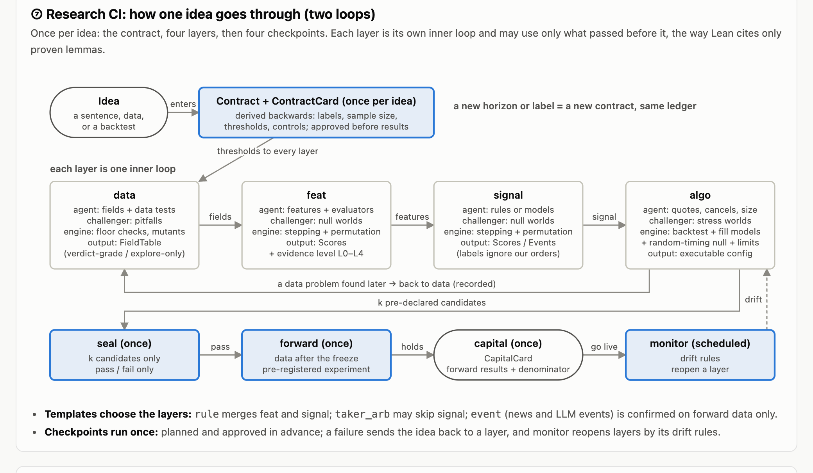

# Research CI

A backtest framework for research: an alpha claim counts only after it passes CI, the same way code does.

> **Status:** early. The time kernel (M1) and the holdout, ledger, and workflow layer with its first CLI commands (M2) are implemented. Nothing computes a verdict yet; the judge arrives in M3. See [Roadmap](#roadmap).

| Area | Works today | Planned |
| --- | --- | --- |
| Time | FieldTable, `asof`, stepping, lookahead checks | Walk-forward helpers |
| Holdout | Explore, seal, and forward tiers; point-in-time labels | Vintage-aware labels |
| Workflow | State machine, budgets, lineage, `next_actions`, templates | Hooks after verdicts |
| Trust | Hash-chained ledger, head anchors, freeze records | Plugin and data snapshot hashes |
| Judge | | Null worlds, calibration, z thresholds, evidence levels (M3) |
| Runner | | Research code in a child process with Arrow exchange (M4) |
| Plugins | | Data sources, consumers, fill models, challenger (M5, M6) |

## Documentation

| Read | For |
| --- | --- |
| This README | What Research CI is, the loops at a glance, a quickstart, the CLI |
| [docs/design.md](docs/design.md) | The full design: principles, architecture, lifecycle, time and leaks, holdout and labels, judging, the challenger, trust, layers, plugins, key decisions and why, prior art, roadmap |
| [docs/walkthroughs.md](docs/walkthroughs.md) | Three worked cases, step by step: a [futures inventory spread](docs/walkthroughs.md#futures-inventory-spread), a [cross-venue maker-taker](docs/walkthroughs.md#cross-venue-maker-taker) strategy, and [text event signals](docs/walkthroughs.md#text-event-signals) |

## Why

Agents made research fast, but judgment did not keep up. The usual loop is: an agent prepares data, writes a strategy, sweeps parameters, shows the best PnL curve, and explains why it works. Every decision in that loop depends on context and gut feeling, and none of it is reproducible.

What a person needs instead is a green light they can trust without reading the research, the way a passing CI run lets you merge without rereading every line. Many agent sessions can then work on ideas in parallel, and the person only handles the few decisions that are theirs to make. A written summary is never the verdict: numbers are judged by code, and summaries are checked against the verdict they cite.

Research CI moves the judgment **before** the results and makes it executable:

- **Falsifiable**: before an idea starts, write down what result would prove it wrong.
- **Executable**: that standard is code. The engine reruns the submission and decides; it never trusts numbers an agent reports.
- **Reproducible**: the standard is frozen before any result is seen. The same inputs always produce the same verdict, byte for byte.

Research code stays free (pandas or polars, rolling windows, sklearn, SHAP, anything); it declares which panel format it wants, and pandas is the default. The kernel itself runs on polars and owns exactly three things:

| Kernel duty | What it guarantees |
| --- | --- |
| **Time** | Research code only ever sees data with `available_at <= t` at each decision time. |
| **Holdout and labels** | Labels are built by the engine from the contract; sealed and forward data are out of the agent's reach. |
| **Verdict** | Scores are compared against null worlds, thresholds rise with the number of trials, and every verdict is logged in a hash-chained ledger. |

## How it works

### Outer loop: one idea, end to end

Each research layer is its own inner loop, and a layer can only use outputs that passed the layer before it. Seal, forward, and capital are one-shot checkpoints: registered in advance, run once, and sent back to an earlier layer if they fail.



| Layer | Question it answers | Output shape | Needs a backtest |
| --- | --- | --- | --- |
| `contract` | What does the trade look like, and what result counts as wrong? | Contract | No |
| `data` | Can these fields support the contract (point-in-time, vintages, breaks)? | FieldTable | No |
| `feat` | Does the feature add information? | Scores | No |
| `signal` | Does the combined signal predict? Raw signals and model outputs both live here. | Scores, Events | No |
| `algo` | Does acting on the signal make money after costs and constraints? | Positions, Quotes, Orders | Yes |

Labels are not a layer and neither is the backtest: the engine builds labels, and the backtest is the evaluator of the `algo` layer.

### Inner loop: every layer runs the same state machine

```text
OPEN                                  STALE (an upstream stage was reopened)
 |  register (agent)                    |  register (agent): new version
 v                                      v
REGISTERED <--------------------------------------------+
 |  challenge (challenger adds null worlds, pitfalls)   |
 v                                                      |
CHALLENGED <------------+                               |
 |  check (calibration) |  calibration failed,          |  register again after
 v                      |  or new nulls were added      |  the freeze:
CHECKED ----------------+                               |  new version
 |  approve (a person, at a terminal)                   |
 v                                                      |
FROZEN -------------------------------------------------+
 |  submit (1 trial)
 v
PASSED .............. the next stage can start
FAILED / TAINTED .... change the research code and submit again (1 more trial)
PAUSED .............. the budget is used up; a person extends it
```

- Exploration is allowed in any state. It never changes the state and is never counted as a trial.
- Each layer gets a submission budget from the contract, shared across its versions, so a new version does not reset it.
- A submission is TAINTED when anything frozen at approval has changed, for example the contract or the engine.
- Reopening a layer that has passed marks every started layer after it STALE, and nothing downstream can move until the reopened layer passes again.
- Checkpoints run once. A failed checkpoint sends the idea back to a layer.
- There is no separate state file. Every transition is a ledger record, the state is replayed from the ledger, and every command refuses to run on a ledger whose hash chain is broken.

### Who does what

```text
research agent           human                     scheduler
explore, submit          approve, capital card     forward, monitor
      |                     |                           |
      +---------------------+---------------------------+
                            |
                         rci CLI
                            |
                        workflow  ---------- spawns ------------>  challenger
              (state machine, next_actions)                        (separate LLM process,
                            |           <---- null worlds, tests    reads files only)
                            |
                     kernel + stages
                (deterministic, no LLM)
```

The library is passive. It knows the state, decides which transitions are legal, and computes. Every driver reads the same `next_actions()` list: `rci next` prints it for one idea, and `rci inbox` collects everything that waits for a person across all ideas. Only a person at an interactive terminal can approve; an agent calling `rci approve` is refused.

## Quickstart

Requires Python 3.11+ and [uv](https://docs.astral.sh/uv/). Install the engine into the project that will hold your ideas, pinned to a commit:

```sh
uv add "research-ci @ git+ssh://git@github.com/alva-ai/research-ci@<sha>"
```

Start an idea, write its contract, and let a person freeze it:

```text
$ rci init ideas/tox -t maker_arb
created ideas/tox (maker_arb); edit ideas/tox/contract.py, then run `rci contract derive -i ideas/tox`

$ rci next -i ideas/tox
agent      rci contract derive                  write contract.py, then derive the contract
```

```python
# ideas/tox/contract.py
from research_ci.api.contract import Contract

CONTRACT = Contract(
    template="maker_arb",
    claim="Taker toxicity on venue A predicts 5s markouts of passive fills on venue B",
    explore_end="2025-06-30T00:00:00Z",
    seal_end="2025-12-31T00:00:00Z",
    budget=20,
)
```

```text
$ rci contract derive -i ideas/tox
contract registered: Taker toxicity on venue A predicts 5s markouts of passive fills on venue B
a person freezes it with `rci approve --stage contract`

$ rci inbox ideas
ideas/tox                rci approve --stage contract         review the contract and freeze it

$ rci approve --stage contract -i ideas/tox          # a person, at a terminal
approve contract v1 of tox
  budget: 20
  claim: Taker toxicity on venue A predicts 5s markouts of passive fills on venue B
  explore_end: 2025-06-30T00:00:00Z
  seal_end: 2025-12-31T00:00:00Z
  skip: []
  template: maker_arb
  frozen dependencies:
    contract             612ac683c236
Freeze contract v1? [y/N]: y
frozen contract v1: 61ca8cf8628e
to keep it in git: git add ideas/tox/.rci ideas/tox/contract.py && git commit -m 'rci: freeze contract of tox'

$ rci status -i ideas/tox
tox (maker_arb)
  contract  PASSED      v1
  data      OPEN        v1   0/20
  feat      OPEN        v1   0/20
  signal    OPEN        v1   0/20
  algo      OPEN        v1   0/20
  seal      OPEN        v1
  forward   OPEN        v1
  capital   OPEN        v1
  monitor   OPEN        v1

$ rci next -i ideas/tox --json
[
  {
    "who": "agent",
    "stage": "data",
    "kind": "register",
    "command": "rci data register",
    "reason": "declare how this stage will be judged"
  }
]
```

`rci data register` is where the current release stops: the per-layer commands arrive with the judge in M3. Engine state lives in `ideas/<idea>/.rci/` (commit it with the idea) and in `$RCI_HOME` (default `~/.rci`), which keeps each ledger's latest head outside the idea.

## CLI

| Command | Called by | Precondition | Available |
| --- | --- | --- | --- |
| `rci init <idea> --template <t>` | agent | none | yes |
| `rci contract derive` | agent | none | yes |
| `rci approve --stage <stage>` | **human**, interactive | upstream passed; calibration passed for layers | yes |
| `rci approve --stage <layer> --extend N` | **human**, interactive | layer PAUSED | yes |
| `rci next`, `rci status`, `rci inbox`, `rci verify` | anyone | none | yes |
| `rci <layer> explore` | agent, unlimited | upstream passed | M3 |
| `rci <layer> register` | agent | upstream passed | M3 |
| `rci <layer> challenge` | challenger | evaluators registered | M3 (challenger in M5) |
| `rci <layer> check` | agent | null worlds present | M3 |
| `rci <layer> submit` | agent, 1 trial each | frozen, budget left; TAINTED if anything frozen changed | M3 |
| `rci seal run`, `rci capital run` | human | plan declared and frozen in advance | later |
| `rci forward --all`, `rci monitor --all` | scheduler | none | later |

`<layer>` is one of data, feat, signal, algo. `status`, `next`, and `inbox` take `--json` for agents. Commands on one idea take `-i <idea>` and default to the current directory; `init` takes the new idea's directory and `inbox` a root directory.

## Templates

| Template | Research type | Layers |
| --- | --- | --- |
| `factor` | Cross-sectional factors | data, feat, signal, algo |
| `rule` | Rule-based strategies | data, signal, algo |
| `event` | News and LLM events | data, feat, signal, algo; confirmed on forward data only |
| `taker_arb` | Taker arbitrage | data, signal (optional), algo |
| `maker_arb` | Maker arbitrage and market making | data, feat, signal, algo with a fill model |

All templates end with the same checkpoints: seal, forward, capital, monitor. The contract of a `taker_arb` idea may skip the signal layer with `skip=("signal",)`.

## Architecture

```text
+------------------------------------------------------------------+
| cli        the rci command                                       |
+------------------------------------------------------------------+
| llm        challenger, narration, summary audit (optional)       |
+------------------------------------------------------------------+
| workflow   state machine, lineage, templates, next_actions       |
+----------------+----------------+----------------+---------------+
| stages         | store          | runner         | render        |
| per-layer      | .rci/, ledger, | research code  | cards from    |
| policies       | freeze, vault  | in a child     | verdict.json  |
+----------------+----------------+----------------+---------------+
| kernel     time, holdout, checks, judge (pure functions, no I/O) |
+------------------------------------------------------------------+
| api        building blocks and plugin protocols                  |
+------------------------------------------------------------------+
     ^
     |  plugins (in a lab) import api only
```

A layer may import only the layers below it. import-linter enforces this in CI, and `reference_plugins` may import only `api`. The engine repo holds no ideas and no real plugins: a lab is any Python 3.11+ project with the engine and its plugins installed, keeping ideas under `ideas/<idea>/`.

| Package | Role | Status |
| --- | --- | --- |
| `api` | Building blocks for research code and plugins: `Contract`, `Criterion`, null declarations, plugin protocols. | `Contract` done |
| `kernel` | Mechanisms, pure functions, no I/O: `time` (asof, stepper), `holdout` (tiers, labels), `hashing`, `checks`, `judge` (derive, nulls, mutate, calibrate, stats, verdict). | `time`, `holdout`, `hashing` done |
| `stages` | Policies, one file per layer: floor checks, floor null worlds, calibration recipe, caps. | M3 |
| `workflow` | Lifecycle: inner state machine, outer dependency graph with STALE invalidation, templates, `next_actions`. | Done |
| `runner` | Process isolation for research code. | M4 |
| `store` | All I/O: workspace `.rci/`, ledger and head anchors, freeze records, environment records, data vault. | Vault planned |
| `render` | Deterministic cards from `verdict.json`, citation checks for summaries. | Planned |
| `llm` | Optional: challenger, card narration, summary audit. Never imported by the kernel or workflow. | Planned |
| `cli` | The `rci` command. | Partly done |

### Process model

Research code never runs in the kernel's process (planned for M4; until then contracts are loaded in-process).

```text
kernel (parent)                                       research code (child)
      |                                                        |
      |-- verify freeze hash, lineage, versions                |
      |-- start child with study code and plugins ------------>|
      |                                                        |
      |   for each decision time t:                            |
      |-- window with available_at <= t (Arrow) -------------->|
      |<------------------------------------------ output at t |
      |                                                        |
      |-- build labels (the child never sees them here)        |
      |-- evaluate(criterion, output, allowed labels) -------->|
      |<------------------------------------------------ score |
      |                                                        |
      |-- null worlds, calibration, verdict, ledger            |
```

A stray `np.random.seed`, an in-place edit, or a monkeypatch in research code cannot change the verdict. Seeds are derived from the freeze hash. This boundary is also where a trusted service would be split out later.

## Trust model

| Situation | Rule |
| --- | --- |
| Normal run in a lab | The engine is installed at a pinned git SHA and read-only. A freeze pins the contract, the engine source, the interpreter, the engine's own dependencies, and the upstream freezes; from M3 also evaluators, nulls, plugins, and the data snapshot. Each submission also records every installed package and `uv.lock`. |
| Anything frozen changes after approval | The submission is TAINTED. Research code and the libraries it uses may change between submissions. |
| Run from this repo in editable mode | Marked DEV, capped at L1. |
| Deliberate cheating | Out of scope for the MVP. Later: a separate OS user or a thin service `execute(bundle, vault, ledger) -> verdict`. |

Git is not a security mechanism, because agents can rewrite history. Trust comes from the engine's own freeze hashes and the hash-chained ledger.

The hash chain catches edited, deleted, and reordered records, but not records cut from the end, such as a failed submission deleted to win back a trial or an older ledger restored from git. For that the engine also keeps each idea's latest head in `$RCI_HOME/heads/` (default `~/.rci/heads/`), outside the idea and keyed by its first record, and refuses a ledger that no longer contains it. A ledger that grew elsewhere, for example pulled from another machine, is accepted as long as it still contains that head.

See [docs/design.md](docs/design.md) for the reasoning behind each rule and what the trust model does not cover.

## Roadmap

| Step | Scope | Acceptance | Status |
| --- | --- | --- | --- |
| M0 | Scaffold, CI, import layers | CI green; layer violations are caught | Done |
| M1 | `tables` + `time` (asof, stepper) | Every planted lookahead is caught; plain rolling reports zero mismatches | Done |
| M2 | `holdout` + ledger + workflow skeleton + `rci next` | Out-of-order calls are rejected; a one-byte edit breaks ledger verification | Done |
| M3 | `judge`: null worlds, z thresholds, evidence levels, stand-ins; per-layer commands | Feat layer end to end on the first real case | Planned |
| M4 | `runner`: child process + Arrow | Verdict cards stay byte-identical when research code reseeds or mutates data | Planned |
| M5 | First data plugin, consumer, minimal challenger | Plugins pass conformance | Planned |
| M6 | Algo: execution simulator, fill models, randomized decisions, constraint criteria | A maker-taker case end to end | Planned |
| Later | Checkpoint commands, verdict hooks, graveyard replay, a thin trusted service | Replaying past ideas kills some of them earlier than they were killed back then, kills no true positive, and every verdict reproduces | Planned |

## Development

```sh
uv sync
uv run rci --help
uv run pytest
uv run ruff check
uv run ruff format --check
uv run basedpyright
uv run lint-imports
npx markdownlint-cli2
```

```text
src/research_ci/
  api/  kernel/{time,holdout,checks,judge}/  stages/  workflow/
  runner/  store/  render/  llm/  cli/  reference_plugins/
tests/unit/  tests/known_answers/
docs/design.md  docs/walkthroughs.md
```
