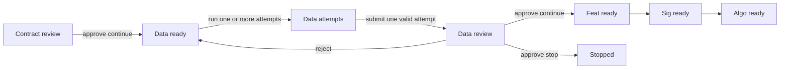
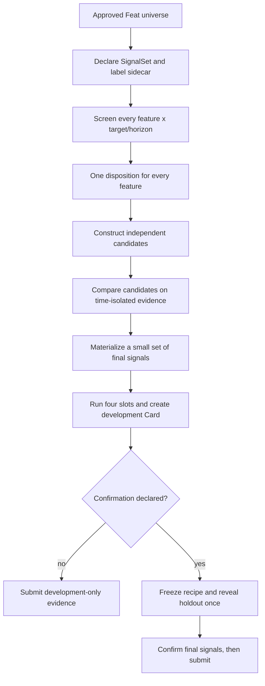

# Research CI design and requirements

> **Status, 2026-10-15:** the MVP path from Contract through Algo is
> implemented and has been exercised on the SK Hynix/SKHY proxy-spread case.
> Optional Sig procedure freeze and one-time confirmation are implemented.
> Secure holdout custody, a tamper-evident ledger, forward evaluation, and a
> built-in backtester are planned. This document states the product requirements
> and stage boundaries. [README.md](../README.md) is the quickstart,
> [TODO.md](../TODO.md) is the implementation ledger, and
> [research-ci-viz-en.html](research-ci-viz-en.html) is the visual version.

Research CI keeps its strongest product idea: an external research agent may
explore freely, while a small deterministic engine owns stage order, output
contracts, reusable checks, evidence records, and review gates. This
implementation deliberately starts with a smaller contract and no universal
statistical verdict. The research target, labels, feature selection, signal
recipe, and portfolio logic become explicit at the stage where they can be
understood.

## Contents

1. [Purpose](#purpose)
2. [Principles](#principles)
3. [System boundary](#system-boundary)
4. [Lifecycle](#lifecycle)
5. [The common stage protocol](#the-common-stage-protocol)
6. [Tables and artifacts](#tables-and-artifacts)
7. [Contract](#contract)
8. [Data](#data)
9. [Feat](#feat)
10. [Sig](#sig)
11. [Algo](#algo)
12. [Review and approval](#review-and-approval)
13. [Current guarantees](#current-guarantees)
14. [Planned work](#planned-work)

## Purpose

Research agents can generate data pipelines, features, models, and backtests
faster than a reviewer can reconstruct their assumptions. Research CI turns that
work into a sequence of inspectable stage products. At every boundary a
reviewer can answer five questions without recovering the agent's chat:

1. What table entered the stage?
2. What table or strategy definition left it?
3. Which general methods did the agent deliberately select, and why?
4. Which rules were specific to this case, and do their counterexamples fail?
5. What exactly is being approved for the next stage?

The MVP succeeds when an external Lab can start from a small Contract, explore
inside each stage, emit typed Polars tables and evidence, and stop on a stable
Card for human or agent review. Approval moves only the reviewed artifact to
the next stage.

Research CI is not an alpha oracle. It does not infer that a strategy is good
from one score, automatically choose the largest IC, or turn a backtest into a
live-trading claim. It makes the reasoning path complete and reviewable.

## Principles

### One ordered pipeline

The default order is:

```text
Contract -> Data -> Feat -> Sig -> Algo
```

A Contract may omit a later stage, but enabled stages retain this order. A
stage reads only an approved upstream product. Producing a new upstream Card
locks downstream stages until the new Card is approved.

### A small Contract

The Contract is the broad task boundary: mission, enabled stages, scope, and
invariants. It does not freeze labels, horizons, models, or economic results.
Those are often unknown before Data and Feat exploration. They become explicit
inside Sig and Algo, with their own evidence and approval.

The Contract itself does not have four eval slots. It is validated for
structure and stage order, rendered as a Card, and approved once before Data
work begins.

### One main table per stage

Every stage has one formal handoff table. Intermediate metrics, eval results,
labels, candidate tables, models, charts, and reports are sidecars. Eval code
must not append temporary columns to the formal main table.

The handoff tables are independent artifacts:

```text
data/main.parquet -> feat/main.parquet -> sig/main.parquet -> algo/main.parquet
```

### Wide by default

For fixed instruments or a fixed pair, one row represents one time and the
table is wide. A long table is appropriate when the natural grain is a true
cross-section such as `(event_time, inst)`, or when an Algo contract represents
individual trades. The Engine does not convert a naturally wide pair into a
long table for uniformity.

### Research freedom outside, fixed mechanics inside

The Lab owns source downloads, exploration, feature ideas, estimators, signal
recipes, portfolio rules, and external backtests. The Engine owns stage order,
declarations, four-slot execution, artifact layout, Cards, and approval state.

### Columnar first

Engine baselines and most reusable methods operate on whole Polars columns,
preferably in one or a small number of `select` operations. Matrix methods
such as PCA, VIF, and mutual information first select and clean their matrix in
Polars, then call NumPy or scikit-learn. A case runner may use other code when
the method cannot be expressed as `pl.Expr`, but it remains explicit.

### Evidence stays evidence

Correctness rules may stop a stage. Diagnostics describe quality, redundancy,
stability, predictive association, or economics. They do not become a hidden
single score. The Card reports what is valid, incomplete, redundant, unstable,
weak, costly, or still needs review.

## System boundary

### Engine repository

The Engine is a Python package and CLI installed with `uv`. Its current
structure is intentionally direct:

```text
src/research_ci/
  contract.py      small Contract and structural validation
  workflow.py      ordered stage states and approval provenance
  cli.py           external builder, plan, backtester, and renderer entrypoints
  cards.py         deterministic Markdown Cards and stable Card IDs
  eval/
    declarations.py  DataSet, FeatureSet, SignalSet, AlgoSet
    baseline.py      fixed correctness floor
    registry.py      reusable-method metadata
    menu.py          stage-scoped selectable menu
    selection.py     external agent selection -> executable EvalSpecs
    library/         methods grouped by methodology
    defaults/        stage-specific proposals
    policies/        hard semantic boundaries between stages
  kit/
    data.py feat.py sig.py algo.py viz.py
```

Method libraries are grouped by methodology—quality, temporal, structure,
association, information, stability, and economic—not copied once per stage.
The registry says where each method is valid. A compiled stage menu then
filters the shared library by stage policy and the current declaration.

Kit modules are grouped by construction stage because they help external Labs
build products. A Kit is optional. It is not an eval slot, an allowlist, or an
extra workflow stage.

### External Lab

The Lab owns one directory per research case:

```text
lab/<case>/
  contract.py
  data.py
  feat.py
  sig.py
  algo.py
  backtest.py
  visualize.py
  evals/
    data.py
    feat.py
    sig.py
    algo.py
  raw/
  context/
```

The Agent may create more files, download additional sources, fit estimators,
and save case-specific artifacts inside the Lab. The formal interface remains
the declared builder result and the four-slot plan.

## Lifecycle

> **Status:** implemented for Contract, Data, Feat, Sig, and Algo.



Feat, Sig, and Algo use the same `ready -> attempts -> review` protocol shown
for Data. Sig inserts `freeze -> one-time confirmation` before submit when its
plan declares a confirmation holdout. The short arrows between stages mean
that the submitted Card was approved with `continue`, not that a stage run
approved itself.

Every enabled stage is in one of these states:

| State | Meaning |
| --- | --- |
| `locked` | An earlier enabled stage has not been approved. |
| `ready` | The upstream artifact is approved and the Agent may run this stage. |
| `review` | One valid attempt was submitted as the formal candidate; only a reviewer may act. |
| `approved` | The submitted Card was explicitly approved with `continue`. |
| `stopped` | The submitted Card was explicitly approved with `stop`; the workflow ends without advancing. |
| `disabled` | The Contract omitted this stage. |

Attempt validity is not a workflow state. A failed mandatory check marks that
attempt `invalid`, leaves the stage `ready`, and prevents submission. A valid
attempt also leaves the stage `ready`, so the Agent may inspect it, improve the
Lab, and run again. Only `submit` chooses one valid attempt and moves the stage
to `review`. Cards expose these as separate fields: `workflow_state` remains
one of the six states above, while `artifact_role` is `attempt` or `candidate`.

In `review`, the reviewer may approve with `continue`, approve with `stop`, or
reject with a reason. Rejection returns the stage to `ready`; the Agent must
produce a new attempt before resubmitting. Reopening an approved or stopped
stage is an explicit human action and locks every downstream stage again.

The workflow does not assume which Agent implementation drives it. The CLI is
the authority for legal transitions: a skipped or out-of-order command is
refused with an error code and the exact next legal actor, command, and reason.
`rci next --json` exposes the same instruction for an orchestrator.

## The common stage protocol

> **Status:** implemented for Data, Feat, Sig, and Algo.

Each stage after Contract follows the same outer protocol:

1. Refuse the run unless the stage is exactly `ready`.
2. Read the approved upstream `main.parquet`.
3. Execute an external Lab builder without allowing it to mutate the input.
4. Validate the builder result against a stage declaration.
5. Build the external Agent's selected library plan and case rules.
6. Run four slots against the formal table and explicit sidecars.
7. Save an immutable numbered attempt containing the main table, research
   artifacts, eval report, assessment, Card, and manifest.
8. Record the attempt as `valid` or `invalid` while the stage remains `ready`.
9. For a Sig attempt with a declared confirmation holdout, freeze the selected
   procedure and run that holdout once before submission.
10. Submit one valid eligible attempt to publish it as the formal candidate and
    enter `review`.
11. Wait for explicit approval or rejection before any downstream work.

### The four slots

| Slot | Owner | Requirement | Result |
| --- | --- | --- | --- |
| `baseline` | Engine | Fixed correctness floor for the stage. It validates schema, keys, finite values, source preservation, and stage-specific protocol coverage. | May stop execution when a required invariant fails. |
| `library` | Engine implementation, external Agent selection | The Agent chooses methods from the compiled menu, with scope, parameters, reason, and failure policy. The Engine does not silently select every available method. | Metrics or findings from reusable methods. |
| `case` | External Lab/Agent | Task-specific definitions and assumptions, preferably `pl.Expr`/`select`, with a custom runner when necessary. | Verifies what this case means. |
| `case_eval` | External Lab/Agent, executed by Engine | Tests Slot 3 with valid fixtures and invalid or counterexample inputs. | Proves the case rule can fail for the error it claims to detect. |

All four slots read the same formal main table. Sidecars are supplied through
an explicit `EvalContext`; they are not merged into the main artifact merely
to make an eval convenient.

### Library selection

The reusable library is a menu, not a mandatory checklist. The Agent must
select methods available to the current stage and declaration:

```python
LibrarySelection(
    (
        SelectedMethod(
            "library.association.spearman_ic",
            reason="rank association is meaningful for this monotone score",
            on="candidates",
            parameters={...},
        ),
    )
)
```

Every execution record preserves the registered method name, execution mode,
selection reason, status, metrics, findings, and reason code.

## Tables and artifacts

### Main-table ownership

| Stage | Formal input | Formal output | Excluded from the main table |
| --- | --- | --- | --- |
| Data | Contract plus Lab sources | Joined, point-in-time research data | Labels, outcomes, feature candidates, eval columns |
| Feat | Approved `data/main.parquet` | Keys plus target-free feature columns | Labels, targets, fitted target-aware transforms, signals |
| Sig | Approved `feat/main.parquet`; Data may be read only to assemble the direct Algo handoff | Keys, context/prices needed by Algo, and final signal columns | Labels, screening metrics, rejected features, research candidates |
| Algo | Approved `sig/main.parquet` | Prices/signals plus positions, weights, or trade rows | Backtest paths, PnL summary, eval columns |

### Common runtime layout

Data, Feat, Sig, and Algo first write under a numbered attempt directory. A
valid submitted attempt is then published at the stage root:

```text
attempts/
  0001/
    main.parquet
    recipe.json
    artifacts/
    eval/report.jsonl
    eval/assessment.json
    card.md
    manifest.json
main.parquet            submitted candidate only
recipe.json
artifacts/
eval/report.jsonl
eval/assessment.json
card.md                 review Card with Agent recommendation
manifest.json
candidate.json          submitted attempt and Card identity
approved.json           created only after explicit approval
plots/                  optional and generated only on request
```

Stage-specific research tables remain next to these common artifacts. The
attempt history remains available after submission. The manifest is the
index; the Card is the review entry point; Parquet and JSONL hold the complete
evidence.

## Contract

> **Status:** implemented.

The Contract establishes the largest stable boundary that is knowable before
research starts:

```python
Contract(
    mission="Test whether the SK Hynix/SKHY proxy spread mean-reverts",
    stages=("data", "feat", "sig", "algo"),
    scope=("xyz:SKHX", "xyz:SKHY", "hourly"),
    invariants=("point_in_time", "review_each_stage"),
)
```

Requirements:

- `mission` is non-empty.
- Enabled stages are unique and preserve Data -> Feat -> Sig -> Algo order.
- `scope` describes the broad asset and research boundary.
- `invariants` name requirements that should survive later exploration.
- Labels, horizons, methods, models, positions, PnL, and profitability claims
  are not Contract fields.
- The Contract Card must be approved before Data runs.

## Data

> **Status:** MVP implemented.

Data is the Agent's source-exploration and assembly stage. It may download new
sources, inspect coverage, reconcile timestamps, and revise joins. Its formal
result is a table whose values mean what their names and times claim.

Requirements:

- Preserve each source at its original cadence before assembly.
- Make timestamp semantics explicit: bar start, bar close, event time, and
  availability time must not be conflated.
- Join slower sources backward/as-of unless the case proves another rule.
- Keep source identity in column names or explicit instrument columns.
- Preserve the natural row grain and unique keys.
- Do not create labels, future returns, strategy outcomes, or PnL.
- Keep eval results outside `data/main.parquet`.
- Record exploration and construction semantics separately from the manifest.

The Data baseline checks the public table contract. Library methods are mostly
columnar quality and temporal checks. Case rules verify source-specific facts
such as OHLC envelopes, symbol identity, derived spread formulas, and funding
availability. `case_eval` plants violations of those definitions.

Data approval means the assembled table is suitable as the sole formal input
to Feat. It does not mean the research idea is correct.

## Feat

> **Status:** MVP implemented.

Feat converts approved Data into reusable, point-in-time, target-free
features. It is allowed to be large: later Sig research must account for every
declared feature rather than silently reading only a convenient subset.

Requirements:

- Read only the approved Data main table.
- Return a Polars table containing keys plus declared features.
- Preserve the Data key grid; rolling warm-up does not justify dropping rows.
- Preserve warm-up nulls unless a fill rule is part of the feature definition.
- Use causal windows ending at the current row.
- Avoid full-sample fitted scalers, PCA, or selection that uses future rows.
- Keep labels, targets, and target-aware metrics out of Feat.
- Recomputing a historical prefix after future rows are removed must not
  change that prefix.

The Feat library covers quality, coverage, dispersion, correlations, VIF,
PCA, feature-feature mutual information, autocorrelation, rank persistence,
and drift. These describe usability and structure. IC, ICIR, target mutual
information, and bucket returns belong to Sig because they require a label.

Hardly computable, non-finite, or exact duplicate features may be rejected
with recorded evidence. High correlation, high VIF, or shared information is
normally recorded or clustered, not silently deleted by the Engine.

Feat approval means the feature table and its structural evidence are ready
for target-aware Sig research.

## Sig

> **Status:** MVP implemented, including full-universe accounting, candidate
> and final separation, label sidecars, time-split artifacts, lineage, target
> methods, and a direct wide Algo handoff.

Sig is the research stage that turns the complete approved feature universe
into one or more predictions, rankings, directions, or intensities. It owns
target-aware feature evaluation and model fitting. It does not own capital
weights, entries, stops, execution, or PnL.

### Sig inputs and declaration

`SignalSet` declares:

- `keys`: the feature-table grain;
- `features`: every feature in the approved Feat main table;
- `targets`: a mapping from research horizon to label-sidecar column, or an
  explicit targetless `hypothesis`;
- `candidates`: every research candidate materialized for comparison;
- `signals`: the small set of final outputs proposed for Algo;
- optional feature/candidate groups;
- `label_table`: the explicit sidecar name;
- `cross_section_by` or `evaluation_by` when aggregation needs it;
- `fit_policy`: `none`, `train_validation_test`, or `walk_forward`.

`ValidationPlan` declares the development design separately from the signal
schema:

- an open list of `ValidationMethod(name, purpose, parameters)` records;
- the deterministic rule used to select and materialize final signals;
- an optional `ConfirmationPlan` naming one holdout, its context table, and a
  predeclared confirmation-plan function.

The method name is not an Engine enum. A case may use rolling K-fold, purged
walk-forward, PBO, clustering stability, nested fitting, or a new case-specific
procedure. The Engine records and freezes that design instead of pretending
one validation method fits every signal problem.

Declaring only the features an Agent already plans to use is invalid. Sig must
start from the whole approved feature universe, so skipped features remain a
reviewable decision.

### Labels, targets, and horizons

A realized future value is called a **label**. Development labels live only in
an explicit sidecar such as `sig/context/label.parquet`. A **target** is the
research role
assigned to a label column for a named horizon. Neither is appended to
`feat/main.parquet` or `sig/main.parquet`.

This separation prevents accidental downstream use and keeps the handoff
table honest. It also permits targetless rules when the Lab states a concrete
hypothesis and selects methods that do not require labels.

When confirmation is declared, the development label sidecar is a non-empty
subset of approved Feat keys. The held-out context is supplied only to
`rci sig freeze`; its keys must not appear in that development sidecar.

### Required Sig research loop



1. **Declare the research question.** Name the label/horizon mapping or a
   targetless hypothesis, the feature universe, candidate names, final signal
   names, and fit policy.
2. **Create chronological evidence.** Any selection or fitted transform uses a
   chronological train/validation/test split or walk-forward process. Labels
   near boundaries must be purged when their horizon crosses the boundary.
3. **Screen the whole universe.** The selected target-aware methods cover every
   declared feature and target/horizon pair. The screening artifact records
   sample, method, value, and sufficient grouping context.
4. **Dispose every feature exactly once.** A `FeatureDisposition` records one
   of `keep_direct`, `keep_as_context`, `representative_of_cluster`,
   `input_to_component`, `reject_quality`, `reject_redundant`,
   `reject_unstable`, or `reject_weak`, together with a reason, named evidence,
   selected outputs, and optional cluster.
5. **Construct candidates.** A candidate may be a direct rule, quantile/bin
   transform, group-balanced mean, PCA component, regression, classifier,
   clustering/regime method, or ensemble. Each candidate has a
   `SignalLineage` record with inputs, method, parameters, fit policy, and
   evidence.
6. **Compare candidates consistently.** Candidates use the same label and
   evaluation conventions. The Card may show a Pareto view of predictive
   evidence, stability, incremental information, turnover proxy, and
   complexity. The Engine does not promote the largest single number.
7. **Materialize final signals.** A final signal has explicit direction,
   scale, null policy, and lineage. Multiple independent final signals are
   allowed. They remain separate strategy candidates unless Sig explicitly
   constructs and evaluates a combined signal.
8. **Freeze and confirm when declared.** The Engine verifies direct source
   hashes, hashes the saved attempt products, marks the holdout consumed, then
   gives the predeclared confirmation function approved features and final
   signals only. Candidate columns stay hidden. Confirmation keys must be
   disjoint from development keys. A changed frozen product cannot be
   submitted.
9. **Build the Algo handoff.** For fixed instruments, the formal Sig main table
   is wide: one row per event time, instrument and price context, and final
   signal columns. A true cross-sectional research problem may declare a long
   grain instead.

### Sig products

```text
sig/main.parquet                    direct formal input to Algo
sig/context/label.parquet           labels, sample/block columns, never handoff
sig/context/metadata.json           split and evaluation context
sig/research/candidates.parquet     all research candidates
sig/research/screening.parquet      feature x target/horizon evidence
sig/research/redundancy.parquet     pairwise redundancy evidence
sig/research/clusters.parquet       structural grouping
sig/research/disposition.parquet    one decision per approved feature
sig/research/lineage.json           every candidate and final signal
sig/selection.json                  explicit promotion decision
sig/recipe.json                     builder semantics
sig/validation_plan.json            development methods and selection rule
sig/provenance.json                 direct builder and plan source hashes
sig/artifacts/                       fitted scaler/model/component parameters
sig/eval/report.jsonl               complete four-slot records
sig/eval/assessment.json            triage and reason codes
sig/confirmation/context/           consumed confirmation sidecars
sig/confirmation/eval/report.jsonl  final-signal confirmation evidence
sig/confirmation/holdout.json       holdout ID/hash, scope, and result
sig/card.md                          review entry point
sig/manifest.json                    schema and artifact index
```

`SignalBundle.main` is the research-stage final signals on the feature key
grid. For a fixed-instrument case, the Lab's `build_main_table(data, signals)`
adds the approved price and instrument context required by Algo. The Engine
checks the direct handoff's key grid, paired `*_inst`/`*_price` columns, and
positive finite prices.

### Sig four-slot requirements

#### Baseline

The Engine must verify:

- key and sidecar shapes;
- the complete approved Feat universe is declared;
- the selected screening plan covers every feature-target pair;
- the saved screening artifact covers the same pairs;
- every feature has exactly one valid disposition;
- every candidate and final signal has role-correct, acyclic lineage;
- candidate and final tables preserve the key grid;
- the direct Algo handoff has a valid wide or explicitly declared
  cross-sectional shape.

General point-in-time replay, fitted-artifact reproduction, and universal
walk-forward enforcement remain planned Engine checks. Until then the Lab
must expose its split, purge, artifacts, and case tests.

For a declared confirmation, the additional Engine floor requires a valid
development attempt, unchanged direct plan and builder sources, a holdout ID
and content hash unused in the run, non-overlapping development and holdout
keys, approved Feat keys, and a confirmation table containing final signals but
no candidates.

#### Library

The external Agent selects only methods justified for the case. Available Sig
method families include:

- Pearson IC and Spearman/Rank IC;
- ICIR over explicit time blocks;
- cumulative IC diagnostics;
- feature-target mutual information;
- quantile or bucket spread;
- early/late or train/validation/test association stability;
- rank persistence and drift;
- target-aware ablation, null/permutation, horizon decay, and concentration as
  they enter the library.

Every method must declare its required shape, grouping, minimum observations,
and target sidecar. An inapplicable method returns `not_applicable` with a
reason instead of fabricating a value.

#### Case

The Lab independently verifies this task's definitions: label formulas,
candidate formulas, final signal formulas, direction, weights used to combine
features into predictions, normalization, split boundaries, and fitted model
configuration. These checks describe prediction construction, not portfolio
capital weights.

#### Case eval

Slot 4 must demonstrate that Slot 3 can detect relevant errors. Examples:

- mutate a signal weight or source feature and require the formula check to
  fail;
- mutate the source series used to build the label and require the label check
  to fail;
- shuffle labels and require target evidence to weaken;
- change future rows and require historical fitted signals to remain stable;
- provide an invalid dimension, missing lineage input, or counterexample and
  require rejection.

### Sig review semantics

Sig approval means the signal definitions, full-feature accounting, fit
policy, and evidence are clear enough for Algo research. It does not mean the
signals are profitable, tradable, or ready for capital.

A Card distinguishes three evidence scopes:

- `development_only`: no confirmation was declared, so all evidence remains
  part of the adaptive research loop;
- `confirmation_pending`: the attempt is valid but cannot be submitted until
  its predeclared confirmation runs;
- `confirmed_holdout`: the frozen final signals passed that one-time run.

A failed reveal is recorded as `confirmation_invalid`, consumes the holdout,
and requires a new attempt and a new holdout. The Engine hashes direct source
files and attempt products. It does not claim transitive dependency capture or
OS-level isolation from a Lab process that deliberately reads protected files.

The reviewer must be able to see:

- how many features were declared and disposed;
- which features feed each candidate and final signal;
- which evidence supported each disposition;
- candidate and final predictive evidence by target/horizon and sample;
- stability and overfit risks;
- the final handoff schema and null counts;
- all artifacts needed to reproduce fitted candidates.

## Algo

> **Status:** minimal AlgoLoop implemented with an external backtester.

Algo converts approved predictions into decisions. It owns entry and exit
rules, rebalancing, position sizing, capital weights, stops, leverage, gross
and net exposure, risk constraints, transaction costs, slippage, capacity,
execution, and PnL.

`AlgoSet.representation` selects one of two contracts:

- `weights`: the Algo main table preserves the Sig time grid and appends
  declared position/weight columns grouped by strategy;
- `trades`: the Algo main table may have multiple rows per signal time with
  explicit trade keys. The Engine still verifies that its source prices and
  signals match the approved Sig rows.

The Lab returns `AlgoBundle(main, metadata, artifacts)`. An explicitly injected
backtester returns `BacktestResult(timeseries, summary, trades, metadata)`.
The Engine does not currently invent fills or PnL.

Algo baselines validate schema, source preservation, key grids, positive
prices, finite positions, declared position and gross limits, backtest return,
equity and turnover paths, and one summary row per strategy. The economic
library recomputes total return, volatility, Sharpe, maximum drawdown, and
turnover from the standardized external timeseries. Case rules validate the
portfolio formula and backtest accounting; their counterexamples must fail.

Algo approval means the declared strategy and external backtest evidence were
reviewed. It is not a live-trading authorization.

## Review and approval

Every submitted Card has a stable ID derived from its rendered body and one
Agent recommendation: `continue`, `stop`, or `uncertain`. The recommendation
is a concise handoff to the reviewer, not a transition and not another eval
verdict.

Approval records:

- stage;
- Card ID;
- `human` or `agent` source;
- decision: `continue` or `stop`;
- timestamp;
- review message.

Cards summarize evidence without discarding the full report. A Card separates
workflow state from eval evidence: a stage can have a valid attempt while its
research evidence is weak, unstable, costly, or otherwise unsuitable to
continue. Those findings inform the recommendation and review decision; they
do not create more workflow states.

Approvals are explicit CLI actions. Research CI never treats file creation or a
successful process exit as approval. `approve --decision continue` unlocks the
next enabled stage. `approve --decision stop` records an intentional no-go and
ends the workflow. `reject --message ...` returns the current stage to `ready`
and requires a new attempt; it does not mutate the submitted attempt.

`rci next` is the single recovery and orchestration interface. It identifies
whether the Agent or reviewer owns the next action and emits a concrete legal
command. A command that tries to skip approval, run while in review, submit an
invalid attempt, approve the wrong Card, or reuse a rejected attempt is
refused before downstream work begins.

Optional visualizations are generated by an external case renderer after a
stage run. They are review aids, not a fifth eval slot or a pass condition.

## Current guarantees

The MVP currently guarantees:

- Contract stage order and explicit review gates;
- one small workflow state machine: `locked`, `ready`, `review`, `approved`,
  `stopped`, and `disabled`;
- append-only numbered attempts separated from the submitted candidate;
- invalid attempts cannot be submitted and rejected attempts cannot be reused;
- structured refusals with the next legal actor, command, and reason;
- only approved upstream main tables enter downstream stage runners;
- external builders cannot mutate input DataFrames;
- stage declarations and exact formal schemas;
- the four-slot protocol and stage-scoped library selection;
- baseline, library, case, and case-eval records in JSONL;
- stable Cards, manifests, recipes, and approval provenance;
- Data/Feat/Sig key-grid preservation for the implemented table contracts;
- full-feature disposition and signal lineage coverage;
- label sidecars separated from formal Feat and Sig tables;
- direct Sig-to-Algo handoff with price context;
- weights and trade-shaped Algo contracts;
- standardized external backtest evidence;
- Polars-first Engine execution with explicit matrix backends;
- open-ended Sig validation declarations without a fixed method enum;
- optional Sig product/source freeze and one-time holdout confirmation;
- final-signal-only confirmation tables with disjoint development keys;
- consumed-holdout tracking by declared ID and byte-content hash.

It does not yet guarantee secure holdout custody outside the Lab filesystem,
transitive source-dependency capture, an append-only cryptographic ledger,
process isolation from a malicious Lab, or a universal statistical threshold
for alpha quality.

## Planned work

The next design work should preserve the MVP boundaries rather than enlarge
the Contract prematurely:

1. General point-in-time replay and fitted-artifact reproduction.
2. Transitive source and data lineage, immutable upstream freezes, and automatic
   downstream invalidation.
3. Secure holdout custody outside the external Lab process when the execution
   environment can enforce it.
4. A built-in reference backtester only after at least two external
   backtesters validate the interface.
5. Standard cost, slippage, funding, borrow, capacity, market-impact, trading
   calendar, and proxy-basis interfaces.
6. Forward evaluation and monitor stages, explicitly marked as new guarantees
   rather than implied by the current workflow.
7. Cross-sectional and event-shaped cases in addition to the fixed-pair wide
   case.
8. Multiple-testing, effective sample size, block/bootstrap, and nested
   walk-forward methods in the Sig library.

Earlier designs remain useful prior art for stronger custody, calibration,
null worlds, freezes, and ledgers. The current implementation should adopt
those mechanisms only when they fit this stage-table model and can be
demonstrated by real cases.
