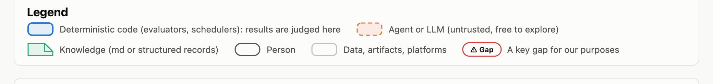
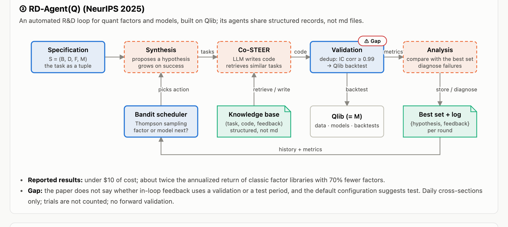
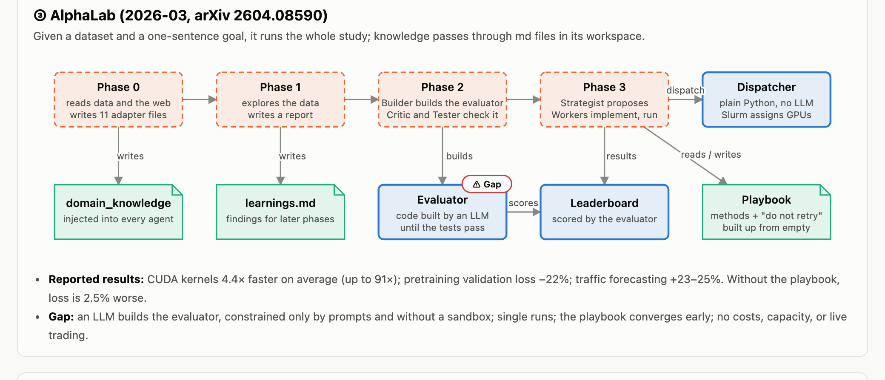
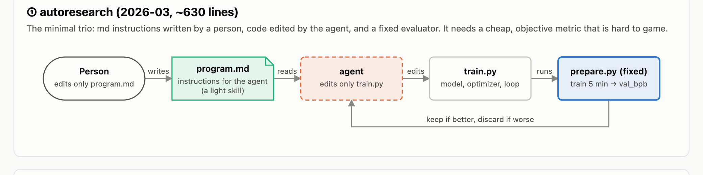
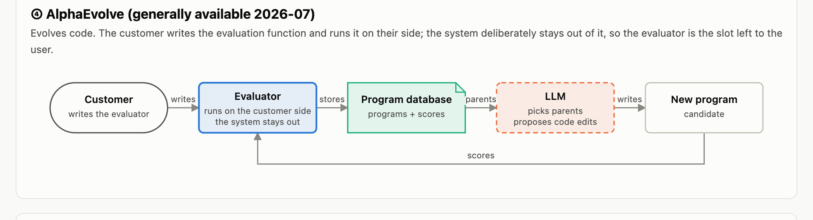
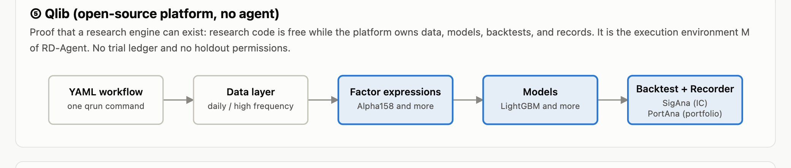
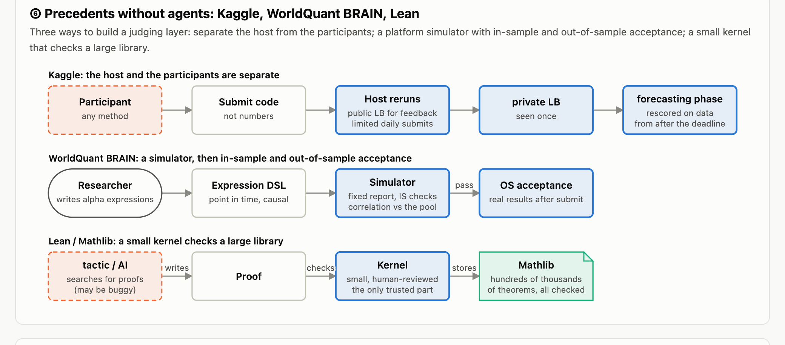
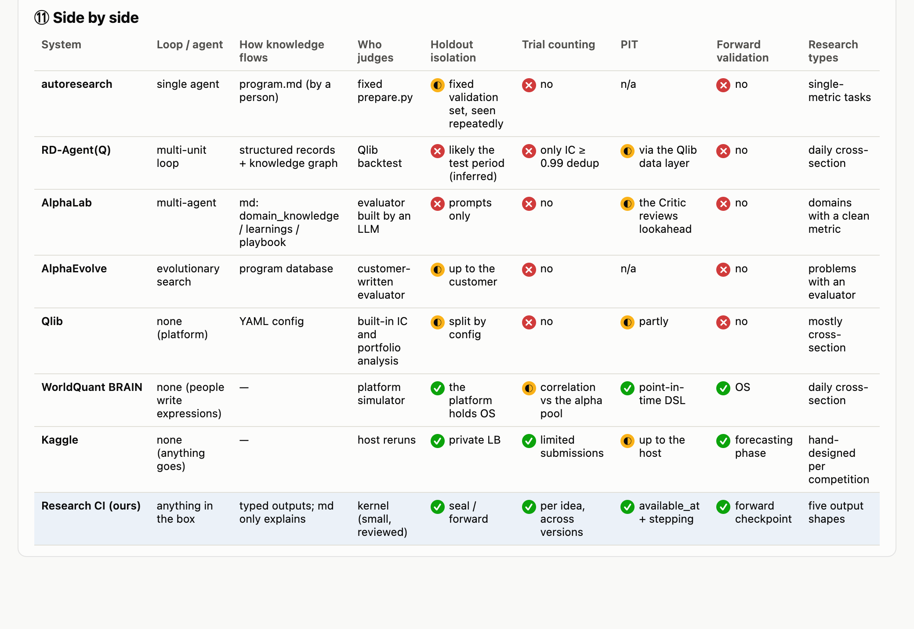

# Research CI design

Research CI is a backtest framework for research: an alpha claim counts only after it passes CI, the same way code does. This document is the complete design. It covers the problem, the architecture, how an idea moves from a claim to a verdict, how each guarantee is enforced, and why each choice was made. The [README](../README.md) has a quickstart, and [walkthroughs.md](walkthroughs.md) follows three cases step by step.

Every major section starts with a status line. "Implemented" means the code in `src/research_ci/` does it and tests cover it. "Planned" means it is designed but not built yet, and its commands and APIs may change when it is built. Numbers in examples are illustrative unless the text says they were measured.

Contents:

1. [Purpose and principles](#purpose-and-principles)
2. [Architecture](#architecture)
3. [Lifecycle](#lifecycle)
4. [The contract](#the-contract)
5. [The data layer](#the-data-layer)
6. [The feat layer](#the-feat-layer)
7. [Time and lookahead](#time-and-lookahead)
8. [Holdout and labels](#holdout-and-labels)
9. [Judging](#judging)
10. [The challenger and summaries](#the-challenger-and-summaries)
11. [Trust and reproducibility](#trust-and-reproducibility)
12. [Layers and templates](#layers-and-templates)
13. [Plugins](#plugins)
14. [Key decisions](#key-decisions)
15. [Prior art](#prior-art)
16. [Roadmap and open decisions](#roadmap-and-open-decisions)

## Purpose and principles

> **Status:** partly implemented: time, holdout tiers, the ledger, freezes, and the workflow in M1 and M2; the contract, plugin protocols, and protocol tests in M3a; the data layer in M3b; the feat layer and its judging in M3c.

### The problem

Research agents now produce ideas, code, and backtests faster than a person can check them. The usual loop is: an agent prepares data, writes a strategy, sweeps parameters, shows the best PnL curve, and explains why it works. Every judgment in that loop depends on context and gut feeling, and none of it can be reproduced. A review of our own failed research cases showed the cost. One case took about three months to falsify. A holdout marked as frozen had been used two or three times. A trivial baseline beat the idea four times. At least five ideas died of costs or infeasibility, and five never had enough data to detect the effect they claimed. Most of these could have been found with a few hours of the right checks, before any strategy was written.

Software has an answer to the same problem. Many coding sessions run in parallel, and a person merges when CI is green without rereading every line, because the checks are executable and the same for everyone. Research needs that kind of green light:

- A person must be able to trust it without reading the details. A written summary is not a verdict, least of all one written by the agent that did the work.
- It must work across many ideas and many agent sessions at once. A person makes only the few decisions that are theirs: approving the rules before any result exists, extending a budget, committing capital.
- It must judge every stage, not only the final PnL, so a wrong idea dies at the first stage that can show it is wrong.
- It must accept any kind of idea, structured or not: cross-sectional factors, futures spreads, cross-venue arbitrage, market making, prediction markets, news and LLM-generated events.
- Its rules must be simple, executable, and reproducible.

### What the engine owns

The engine does not judge methods; it judges outputs, the way a backtester does not care whether orders came from a neural network or a chart pattern. Research code is free: pandas or polars, rolling windows, sklearn, SHAP, numba, compiled extensions. The engine owns exactly three things:

| Duty | What it guarantees | Status |
| --- | --- | --- |
| Time | At every decision time, research code sees only rows with `available_at <= t`. | Implemented (M1) |
| Holdout and labels | Label definitions are plugins named in the contract; the engine owns label custody: which data a label sees, when it runs, and who gets the values. Sealed and forward data are out of the agent's reach. | Tiers in M2; label plugins and their protocol tests in M3a; labels reach criteria only through the evaluation table (M3c) |
| Verdict | Real scores are compared with null worlds, thresholds rise with the number of trials, and every submission is logged in a hash-chained ledger. | Ledger in M2; power in M3a; feat judging in M3c; signal and algo later |

Everything specific to a case is a plugin: data sources, candidates, labels, targets, cost models, and backtesters. The engine keeps time, holdout, and verdicts, and it constrains plugins and agent-written code with executable checks and with tests of those checks: universe, label, and consumer plugins pass protocol tests before their output is used, and the protocol tests are themselves shown to catch plugins broken on purpose (see [Plugins](#plugins)).

An agent may do anything else. It may not do three things: see sealed or forward labels and results; report its own numbers as a verdict; change labels, evaluators, or thresholds after seeing results without starting a new version, which the ledger counts.

### Principles

1. **Falsifiable, executable, reproducible.** Before an idea starts, it states what result would prove it wrong. That standard is code, and the engine reruns the submission to apply it; numbers the agent reports and explanations offered afterwards do not count. The standard is frozen before any result is seen, and the same inputs always give the same verdict.
2. **Derive backwards, execute forwards.** The contract starts from the final trade: when decisions happen, what they act on, what trading costs, and the smallest effect worth having; the engine derives from it what the data can decide. Holding is not an input: how long to hold is an output of the layers (feature decay in `feat`, the break-even horizon in `signal`, holding rules in `algo`). Work then runs forwards through the layers, and each layer may use only what passed the layer before it.
3. **Judgment moves before results.** Claims, evaluators, and null worlds are written and frozen before the run. Changing them after seeing results is allowed, but it starts a new version and is recorded.
4. **Constraints are code, not prose.** Markdown explains; code enforces. In every automated research system that works in practice, the judge is code (see [Prior art](#prior-art)).
5. **The engine is thin and dumb on purpose.** The kernel is a few thousand lines of Python with no LLM in it, and everything specific to a case is a plugin. The clever parts (which claims to make, which alternative explanations to rule out) come from agents outside the engine and are checked by fixed machinery inside it. The engine never interprets a feature.
6. **Unseen data is the final judge.** Every criterion computed on the explore tier reuses the same data, so the results are correlated and are not independent evidence. The seal and forward tiers are.
7. **Guard against false greens first.** An evaluator that is too strict only hurts its author. The system must stop results that should fail from passing. Calibration still tests both directions, because a null world that kills everything is as broken as one that kills nothing.
8. **The engine is passive.** It knows the state, decides which commands are legal, and computes. Something outside always drives it: a research agent, a person, a scheduler, later an orchestrator. All of them read the same `next_actions()`.
9. **The MVP defends against accidents, not attacks.** It stops honest mistakes and lazy shortcuts. A process or service boundary is added when deliberate cheating has to be stopped (see [Threat model](#threat-model)).

### Vocabulary

| Term | Meaning |
| --- | --- |
| Idea | One claim and everything done to test it: a directory with `contract.py`, research code, and the engine's `.rci/` state. |
| Contract | The claim and the rules its verdicts are held to, written before any search: the decisive effects, alternative explanations, data already used, the plugins it relies on, decision times, tier cutoffs, baseline, forward source, deadline, budget, skipped stages. See [The contract](#the-contract). |
| Spec | What `rci contract derive` computes from the contract: the data snapshot, the decision grid, the candidates, protocol test results, power and the minimum detectable effect (MDE) per decisive effect, the consumer pilot, how long new data would take, and whether the claim is decidable. |
| Plugin | Case-specific code in a lab, named in the contract as `Use(name, options)` and loaded by entry point: a data source, universe, label, target, cost model, or consumer. |
| Protocol test | An engine-owned test a plugin must pass before its output is used, such as "the label does not read past `t + h`". |
| Label | An outcome after each decision, computed by a label plugin for each horizon of the contract. |
| Target | A plugin that turns one horizon's label rows into the one number per decision time the claim is about. |
| Consumer | A plugin that runs a strategy's own logic, such as a backtester; the evaluator of `algo` and of effects measured "through the consumer". |
| Pilot | An uninformative change of the same kind as the idea, run through the consumer at derive time to measure how much its results move by chance. |
| Approval provenance | Who approved a stage and through which channel: a person at a terminal, a person's words relayed by an agent, or the agent itself. |
| Stage | One step of an idea: the `contract`, a layer, or a checkpoint. |
| Layer | `data`, `feat`, `signal`, or `algo`. Each runs the same inner loop. Labels are not a layer, and the backtest is not a layer; it is the evaluator of `algo`. |
| Checkpoint | `seal`, `forward`, `capital`, or `monitor`: registered in advance, run once. |
| Template | The list of layers an idea goes through, fixed at `rci init`. |
| Output shape | What a layer produces: a FieldTable for `data`, then Scores, Events, Positions, Quotes, or Orders. |
| Evaluator | A function written by the agent that turns an output and labels into one number. |
| Criterion | One pre-registered way of testing the claim, backed by an evaluator. `stat` criteria are compared with null worlds; `limit` criteria are hard limits compared directly. |
| Null world | A world with the claimed information removed and the alternative explanation kept. The real score must beat the scores in these worlds. |
| Stress world | A world where an optimistic assumption is broken: thinner depth, failed hedges, a replayed incident. Used by `algo`. |
| Calibration | `calibrate`, the test of the tests: stand-ins must fail, planted signals must pass, mutants must be caught. |
| StandIn | A fake output that contains only the alternative explanation. If it passes, the null world is too weak. |
| Planted | An output with known real information planted in it. If it fails, the null world is too strict. |
| Mutant | A copy of the data or of an evaluator with a defect planted in it, such as a shifted `available_at` or a level break. The tests must catch it. |
| Pitfall | A domain-specific mutant, kept in the plugin of the data source it belongs to. |
| Challenger | A separate LLM process, fed only files, that writes null worlds and pitfalls against the registered tests. It never judges. |
| Tier | explore (numbers visible), seal (pass or fail only, one use per idea), forward (data created after the freeze). |
| Trial | One submission. Every submission counts, across all versions of a stage. Exploration never counts. |
| Version | A stage's tests as frozen at one approval. Changing the tests after the freeze starts a new version. |
| Freeze | Hashes of everything a stage's verdict depends on, taken when the stage is approved. |
| Ledger | The append-only, hash-chained record of every state change of an idea. State and trial counts are replayed from it. |
| Head anchor | The latest ledger hash, kept outside the idea in `$RCI_HOME/heads/`, so records cut from the end are noticed. |
| Lineage | The upstream stages and outputs a stage depends on. Reopening an upstream stage makes started downstream stages STALE. |
| Evidence level | L0 to L4: how much independent evidence a verdict has, with caps. |
| Cards | ContractCard, StageCard, VerdictCard, CapitalCard: one-screen views rendered from engine files, never written by an LLM. |

## Architecture

> **Status:** partly implemented: `kernel` (tables, time, hashing, holdout tiers), `store`, `workflow`, and part of `cli` in M1 and M2; `api` (the contract and plugin protocols), the plugin protocol checks and power, `stages/contract.py`, `runner` (plugin loading), the data vault, `render` (the ContractCard), and `reference_plugins` in M3a; the data checks and the data stages in M3b; the feat policy, the verdict rules, and the eval library with its obligations in M3c; the other layer policies later, the child process in M4, `llm` from M5.

### Packages

The engine separates trust, method, policy, and lifecycle. The kernel is small and holds only what a verdict's correctness rests on. `eval` is the library of methods the engine executes, and it grows: each method carries its own worked examples and properties. `stages` holds the rules of each layer: which methods are its floor and how they are put together. `workflow` holds the lifecycle. A new method is a new file in `eval`; a new rule for one layer changes a policy file; neither changes the kernel.

| Package | Owns | Status |
| --- | --- | --- |
| `api` | The only package research code and plugins import: `Contract` and its parts (`api/contract.py`), the plugin protocols (`api/plugins.py`), and what a layer file declares: `Criterion` (`api/study.py`) and null worlds (`api/nulls.py`). | Contract and protocols in M3a; criteria and nulls run by feat from M3c |
| `kernel` | What a verdict's correctness rests on, as pure functions without I/O: `tables` (FieldTable), `time` (`asof`, `step`, `check_leaks`, clock helpers), `hashing`, `holdout` (tiers), and `verdict`: the check record, the floor shuffle, z scores, GridMax, power, and the decisive rule. | `tables` and `time` in M1; `hashing` and `holdout` in M2; power in M3a; the rest of `verdict` in M3c |
| `eval` | The engine's library of executable methods, which grows: `protocol` (checks every plugin must pass), `data` (baseline, replay, reconciliation, declared invariants, treatments, pits), `statistics` (rank IC, quantile spread), `structure` (filters), `calibration` (stand-ins and planted signals); `synthetic` builds markets and sources with known information and faults, and `obligations` runs each method's worked examples and properties on them (see [The eval library](#the-eval-library)). It may import only `api` and `kernel`. | Protocol checks in M3a; data checks in M3b; the rest, and every method's obligations, in M3c |
| `stages` | One policy file per stage. Today `contract.py`, which derives the Spec, `source.py` and `data.py`, which admit a data source and check an idea's data, and `feat.py`, which registers a method and judges features. Later `signal.py`, `algo.py`, and one per checkpoint, `seal.py`, `forward.py`, `capital.py`, `monitor.py`: floor checks, floor null worlds, the calibration recipe, caps. | `contract.py` in M3a; `source.py` and `data.py` in M3b; `feat.py` in M3c; the others planned |
| `workflow` | The state machine, lineage, templates, `next_actions`, approval provenance, and the commands that apply transitions: `base.py` holds what every stage shares, each stage adds its commands in a module of its own, and `idea.py` puts them together. | Implemented (M2); approval provenance in M3a; one module per stage in M3c |
| `runner` | Plugin loading: builds each plugin from its entry point with the contract's options and hashes its code. Later, research code in a child process, with data exchanged as Arrow. | Plugin loading in M3a; child process planned (M4) |
| `store` | All I/O: the `.rci/` workspace with atomic writes and a lock, the ledger with head anchors, freeze records, environment records, and the data vault, content-hashed snapshots under `$RCI_HOME/data/`. | Implemented (M2); vault in M3a |
| `render` | Cards rendered deterministically from engine files, one module per stage: the ContractCard, SourceCard, DataCard, MethodCard, and ResultCard; later the other cards and citation checks for summaries. | ContractCard in M3a; data cards in M3b; feat cards in M3c; the rest planned |
| `llm` | Optional: the challenger, card narration, summary audit. | Planned (M5 and later); no package yet |
| `cli` | The `rci` command, a thin layer over `workflow`. | Partly implemented (M2 to M3c) |
| `reference_plugins` | Generic plugins with no privileges: labels `ref.return`, `ref.markout`, `ref.carry`; target `ref.mean`; cost model `ref.flat_costs`. Toy plugins on synthetic data, with deliberately broken variants, live in `tests/toy.py`. | Implemented (M3a) |

### The eval library

> **Status:** implemented (M3c) for the methods that exist: plugin protocol checks, data checks, statistics, structure, calibration.

Like a proof assistant's library, `eval` grows without bound and is trusted only because every entry is checked. A method's module holds its implementation and its obligations, declared with `research_ci.api.methods`:

- `CASES`: answers worked by hand, `Case(name, run, expect)`. Some run on one small table; others run on several synthetic sources and count, such as "a planted gap is caught on every one of ten sources".
- `PROPERTIES`, for statistics: `Size` (on markets without information, it beats the floor world no more often than chance allows), `Power` (with a known rank IC it beats the floor world often enough), `Recovers` (its mean comes back as planted). They are judged the way a submission is: block means against the floor world, as a z score.

`eval/synthetic.py` builds the inputs: markets (`Market`: entities in clusters and groups, fat tails, a known rank IC) and field tables (`Source`: an hourly price, settled flows known after a lag, revisions as second vintages). `tests/eval/test_obligations.py` finds every method under `eval/data`, `eval/statistics`, `eval/structure` and `eval/calibration`, requires worked examples, runs all obligations, and shows that they fail for a wrong method. Writing them found three bugs the toy tests had missed: the quantile spread took three of five candidates for the top two fifths, the baseline called the value after a one-hour spike a lasting drop, and a lasting move was flagged once per hour until the median caught up.

`tests/incidents/` holds real incidents as small slices of public market data, each with the check that must keep catching it: candles dropped with hindsight around a jump (reconciliation) and a ticker reused for a new contract (baseline gaps).

### Import layers

```text
cli                                  the rci command
 |
llm                                  optional LLM code: challenger, narration, audit (planned)
 |
workflow                             state machine, lineage, templates, next_actions
 |
stages                               per-stage policies: contract derivation today
 |
runner                               plugin loading and code hashes; later the child process
 |
store    render                      independent: neither imports the other
 |
eval                                 the methods the engine executes, with their obligations
 |
kernel                               what a verdict rests on: no I/O, no LLM, no plugins
 |
api                                  building blocks and plugin protocols

reference_plugins, and every plugin in a lab: may import api only
```

A package may import only packages below it. import-linter enforces both rules in CI (`uv run lint-imports`), and the configuration was checked by planting violations on purpose. Three consequences follow. The kernel, the stage policies, and the workflow cannot import `llm`, so the code that computes verdicts cannot call an LLM. Plugins never see engine internals, and the kernel never imports plugins: `runner` loads them through the entry-point group `research_ci.plugins`, and the kernel's protocol tests receive them only as callables. The challenger is started by a command, not called from the state machine. import-linter checks only imports between engine packages; that the kernel uses no model client and no network rests on its dependency list and on review.

### Library and lab

The engine repository is a library and a CLI. It holds no ideas, no strategies, and no data-source code. A lab is any Python 3.11+ environment with the engine and a plugin package installed. Usually it is a separate lab repository, mostly a plugin package plus the home for new ideas; any other Python 3.11+ project can host ideas by installing both.

```text
research-ci/                     the engine: library and CLI only
  src/research_ci/               packages above
  tests/<package>/, tests/incidents/, tests/toy.py

<lab>/                           a lab repository, or any Python 3.11+ project
  pyproject.toml, uv.lock        research-ci pinned to a git SHA, a person commits that line;
                                 plugins registered under the entry-point group research_ci.plugins
  src/<lab_package>/plugins/     real plugins: data sources, universes, labels, targets, cost models,
                                 consumers, fill models, pitfalls
  src/<lab_package>/shared/      shared research tools
  ideas/<idea>/
    contract.py                  written by the agent, frozen at approval
    data.py feat.py signal.py algo.py   one module per layer: tests and criteria, frozen at approval
    research/                    features files, one per submission (any path)
    nulls/                       written by the challenger
    .rci/                        written only by the engine

$RCI_HOME (default ~/.rci)       per user, outside every repository
  heads/                         ledger head anchors (M2)
  data/                          the data vault: <source>/<hash>.parquet (M3a); forward/, cache/ (planned)
```

- The engine changes slowly and every verdict pins it, so it is reviewed and versioned on its own. Ideas and plugins change daily. Keeping ideas out of the engine repository also keeps the engine generic.
- A lab is meant to install the engine at a pinned git SHA. Upgrading the engine changes the `engine` hash in every freeze, so a stage frozen under the old engine must be registered and approved again before it can submit without being TAINTED.
- A lab may install the engine in editable mode while both are being developed. Verdicts made that way will be marked DEV and capped at L1 (planned), so a lab switches to a pinned SHA before real verdicts.
- Both repositories commit `uv.lock` and `.python-version`, because the lab's lock file is part of the recorded environment of each submission.
- Older research repositories are not moved. Lab plugins read their data or call their backtesters.
- Research notebooks are optional; submissions are code (modules or scripts), and the engine calls only agreed entry points.

The `.rci/` directory of an idea holds `ledger.jsonl`, `contract.json` (a copy of the contract fields, the hash of `contract.py`, and the derived Spec), `contract-card.txt` (the ContractCard), `data.json` and `data-card.txt` (the data check and the DataCard), `feat.json` and `feat-card.txt` (the feat method and the MethodCard), `feat-result-<n>.json` and `.txt` (each submission and its ResultCard), `freeze/<stage>.json` (copies of each freeze), and `lock`, which `.rci/.gitignore` excludes. The other cards and audit reports will join it later. Every JSON file is written to a temporary file and moved into place with `os.replace`, so a crash never leaves half a file.

### Data model

Six tables carry everything:

```text
FieldTable   entity, field, event_time, available_at, value, vintage, source      all data (M1)
Panel        rows (time, entity), one column per field, at one moment = asof(t)   (M1)
Output       Scores, Events, Positions, Quotes, or Orders                          (M3c onward)
Labels       (t, entity, horizon) -> outcome, from label plugins, engine custody   (M3a)
Verdict      state, per-criterion scores and z, evidence level, caps, preconditions,
             and the hashes of everything it depends on                            (M3c)
Ledger       append-only, every record carries the hash of the one before it       (M2)
```

The engine judges five output shapes. Methods are unlimited; shapes are not.

| Shape | What it is | How it is judged | Layer | Typical research |
| --- | --- | --- | --- | --- |
| Scores | A number per entity at each decision time | IC, ICIR, residual IC against null worlds | `feat`, `signal` | Factors, ML models, LLM scores |
| Events | Marks at certain moments | Outcome after the event against random times or unselected events from the same source | `signal` | Event studies, news |
| Positions | Holdings, or entries and exits | Backtest PnL against random entries and exits at the same rate | `algo` | Rules, rotations, portfolios |
| Quotes | Resting orders placed, moved, and cancelled | Fill model plugin in an optimistic and a pessimistic version; live trading decides | `algo` | Maker arbitrage, market making |
| Orders | Orders sent now that take liquidity | Simulated fills on recorded books, then small live trading | `algo` | Taker arbitrage |

A cross-sectional study is just one use of Scores: at each time, rank entities and check whether higher scores are followed by better outcomes.

### Data flow

```text
DataPlugin.fetch -> FieldTable (vault) -> visible(tier) -> asof(t) at each decision time -> research code
                                              |                                              |
                                              +--> labels (plugin) -----+              output (shape)
                                                                        v                    |
                                                  evaluators, one per criterion <------------+
                                                             |
                                          real score vs null worlds (and stress worlds)
                                                             |
                                  z vs z_need (n from ledger), calibration, caps -> Verdict
                                                             |
                                                ledger record -> VerdictCard

implemented today: fetch into the vault, FieldTable, visible, asof, step, check_leaks, label plugins, power, ledger
```

### Process model

From M4, research code never runs in the kernel's process. Until then, `step` and `check_leaks` call research functions in the same process, and `rci contract derive` imports `contract.py` and runs plugins in-process, consumer runs in a thread pool.

```text
kernel (parent)                                       research code (child)
      |                                                        |
      |-- verify freeze hash, lineage, version                 |
      |-- load data for the tier                               |
      |-- start one child with study code and plugins -------->|
      |                                                        |
      |   for each decision time t:                            |
      |-- window with available_at <= t, as Arrow ------------>|
      |<------------------------------------------ output at t |
      |                                                        |
      |-- run label plugins in the parent                      |
      |-- evaluate(criterion, output, tier's labels) --------->|
      |<------------------------------------------------ score |
      |                                                        |
      |-- null worlds, calibration, verdict, ledger            |
```

Seeds are derived from the freeze hash, and the child runs with a timeout and a memory limit. A stray `np.random.seed`, an in-place edit of shared data, or a monkeypatch in research code cannot reach the kernel. The acceptance test for M4 is that verdict cards stay byte-identical when research code reseeds or mutates its inputs. Arrow is the exchange format because both pandas and polars read it without conversion.

The process boundary is also where a trusted service would be split out later: `execute(bundle, vault, ledger) -> verdict`. The bundle is the frozen research code and declarations, the vault holds the holdout data, and the ledger is the append-only record. Today all three are local: the idea directory, the local data, and `ledger.jsonl`. The service would be a job executor, not a long-running platform. Status: later.

## Lifecycle

> **Status:** partly implemented: the state machine, versions, budgets, lineage, templates, `next_actions`, and the commands `init`, `status`, `next`, `inbox`, `verify`, `contract derive`, and `approve` in M2; the derived Spec, the ContractCard, per-layer budgets, and approval provenance in M3a; the feat commands and the INSUFFICIENT state in M3c; the other layer and checkpoint commands later.

### Outer pipeline

```text
             reverse derivation: thresholds flow back from the final trade
   <-------------------------------------------------------------------------------
contract -> data -> feat -> signal -> algo -> seal -> forward -> capital -> monitor
   ------------------------------------------------------------------------------->
             forward execution: each stage uses only what passed before it

   |<-------- CI: layers, inner loops -------->|<--- CD: one-shot checkpoints --->|
                         ^                                                 |
                         +------- a drift rule reopens the matching layer --+
```

Every idea has one `contract`, the layers of its template, and the same four checkpoints. The template is chosen at `rci init` and fixed; the template named in `contract.py` must match it. The templates are listed in [Layers and templates](#templates). A later stage that finds a problem sends the idea back: a data problem found in `feat` reopens `data`, a failed checkpoint reopens a layer, and a drift rule in `monitor` reopens the layer it points at.

Each stage is one of three kinds (the contract, a layer, or a checkpoint), and each kind has its own state machine.

### Inner state machine

```text
contract

  OPEN --derive--> REGISTERED --approve (a person)--> PASSED
                    ^    |                              |
                    +----+ derive again                 | derive again: new version,
                    ^      (same version)               | every started stage -> STALE
                    +-----------------------------------+

layer: data, feat, signal, algo

  OPEN
   |  register
   v
  REGISTERED <------------------------------------------------+
   |  challenge                                               |
   v                                                          |
  CHALLENGED <------------------------+                       |
   |  check: calibration passed       |  check failed, or     |  register after the
   v                                  |  challenge again      |  freeze: new version
  CHECKED ----------------------------+  (new null worlds)    |  (from FROZEN, PASSED, FAILED,
   |  approve: provenance recorded                            |  TAINTED, INSUFFICIENT, STALE)
   v                                                          |
  FROZEN -----------------------------------------------------+
   |  submit: 1 trial, the verdict is recorded at once
   v
  PASSED ............ the next stage may start
  FAILED, TAINTED ... change the research code and submit again (1 more trial)
  INSUFFICIENT ...... the data cannot decide yet; a person decides: wait, resubmit, or drop
  PAUSED ............ the budget ran out without a pass; a person extends it
  STALE ............. an upstream stage was reopened; register again (new version)

checkpoint: seal, forward, capital, monitor

  OPEN or STALE --register--> REGISTERED --approve (a person)--> FROZEN --run once--> PASSED
                                                                                      FAILED or TAINTED:
                                                                                      no rerun, reopen a layer
```

The full transition table, from `workflow/machine.py`:

| Kind | Command | Allowed from | Result |
| --- | --- | --- | --- |
| contract | register (`rci contract derive`) | OPEN, REGISTERED, PASSED | REGISTERED. From PASSED this is a new version, and every started downstream stage becomes STALE. |
| contract | approve | REGISTERED | PASSED. The contract's budget and `skip` list take effect. Refused if anything recorded at derive changed or a protocol test failed. |
| layer | register | OPEN, REGISTERED, CHALLENGED, CHECKED | REGISTERED, same version |
| layer | register | FROZEN, PASSED, FAILED, TAINTED, INSUFFICIENT, STALE | REGISTERED, new version. From PASSED, started downstream stages become STALE. |
| layer | challenge | REGISTERED, CHALLENGED, CHECKED | CHALLENGED |
| layer | check | CHALLENGED, CHECKED | CHECKED if calibration passed, otherwise CHALLENGED |
| layer | approve | CHECKED | FROZEN |
| layer | submit | FROZEN, FAILED, TAINTED, INSUFFICIENT | PASSED, FAILED, TAINTED, or INSUFFICIENT. PAUSED instead of anything but PASSED when this submission used the last trial. |
| layer | extend | PAUSED | The verdict of the last submission, FAILED, TAINTED, or INSUFFICIENT |
| checkpoint | register | OPEN, REGISTERED, STALE | REGISTERED. From STALE this is a new version. |
| checkpoint | approve | REGISTERED | FROZEN |
| checkpoint | submit (the checkpoint run) | FROZEN | PASSED, FAILED, or TAINTED |

Everything else is refused with a message such as `cannot approve a layer stage that is OPEN (allowed from: CHECKED)`. Examples: submitting a stage that has PASSED, registering a PAUSED layer, running a checkpoint twice. Before the machine is even consulted, every command checks lineage: all upstream stages must be PASSED or SKIPPED, otherwise `feat is waiting for contract, data to pass`.

The tests hold three invariants over every allowed transition: only a submission (or the approval of a contract) can produce PASSED; a submission always ends in PASSED, FAILED, TAINTED, or INSUFFICIENT at the machine level; and no command produces SKIPPED directly. There is no SUBMITTED state: a submission runs synchronously and records its verdict in the same step.

### Versions

Every stage starts at v1. Registering a stage before its freeze (from OPEN, REGISTERED, CHALLENGED, or CHECKED) edits the current version. Registering it after the freeze (from FROZEN, PASSED, FAILED, TAINTED, or STALE) starts the next version, and the ledger records it. This is how "changing the tests after the freeze is a new version" is enforced.

Research code is different. After a FAILED or TAINTED verdict, the agent changes the research code and submits again against the same frozen tests; that is the normal loop and does not start a new version. Only the tests are frozen.

### Budgets and PAUSED

The contract's `budget` is the number of submissions each layer may use across all its versions: one number for every layer (default 20), or one per layer, such as `{"feat": 12, "signal": 8}`, where layers not named get 20. Every submission counts, including TAINTED ones. A new version does not reset the count, so a failing idea cannot buy fresh trials by re-registering.

When a submission that does not pass uses the last trial, the layer becomes PAUSED instead of FAILED or TAINTED. A PAUSED layer accepts only `extend`; even `register` is refused. A person runs `rci approve --stage <layer> --extend N` at a terminal, and the layer returns to the verdict of its last submission, so the agent can submit again. Checkpoints have no budget, because they run once.

```text
$ rci status -i ideas/tox
tox (factor)
  contract  PASSED      v1
  data      PAUSED      v1   3/3
  feat      OPEN        v1   0/3
  signal    OPEN        v1   0/3
  algo      OPEN        v1   0/3
  seal      OPEN        v1
  forward   OPEN        v1
  capital   OPEN        v1
  monitor   OPEN        v1
$ rci next -i ideas/tox
human      rci approve --stage data --extend N  all 3 submissions used; extend the budget or drop the idea
```

The budget comes from the latest contract approval in the ledger, plus every extension of that layer. A person could also raise it by deriving and approving a new contract version, but that reopens the contract and makes every started stage STALE.

### Lineage and STALE

Every command requires all upstream stages to be PASSED or SKIPPED. Registering a stage that has PASSED reopens it; the same holds for deriving the contract again. Every downstream stage that has started (anything but OPEN, SKIPPED, or already STALE) becomes STALE, with a ledger record noting `data was reopened`. A STALE stage waits until the reopened stage passes again and then must be registered again, which starts a new version.

A second lock sits in the freeze. Each stage's freeze includes `upstream:<stage>`, the freeze hash of each upstream stage's latest approval. If an upstream stage is approved again, any downstream submission against the old freeze would be TAINTED even without the STALE mark.

Later, each verdict will also record the hashes of the upstream outputs it consumed, and a stage may only use upstream outputs that passed. For example, `signal` may only read feature versions that passed `feat`; it cannot compute a new, unjudged feature of its own.

### Optional stages

A template may mark stages as optional: `taker_arb` marks `signal`, and `factor` marks `signal` and `algo`. The contract lists the stages it skips in `skip`, and `rci contract derive` refuses any stage the template does not mark as optional. A `factor` contract may skip `signal` or `algo` only when it improves an existing strategy: it must name the baseline's config and code (`Baseline(score, config=..., code=...)`), and `Contract` refuses it otherwise. The skip takes effect when the contract is approved: the stage becomes SKIPPED, counts as done for lineage, and is left out of downstream freezes. If a later contract version stops skipping it, the stage returns to OPEN.

### Checkpoints run once

A checkpoint is registered with its plan in advance: the k candidates for `seal`, the experiment design for `forward`, the capital plan for `capital`, the drift rules for `monitor`. A person approves the plan, and the checkpoint runs once. A checkpoint that ends FAILED or TAINTED cannot run again. `rci next` then asks a person to reopen a layer (`rci <layer> register`); that marks the checkpoint STALE, and it is registered again after the layers pass. A live experiment is not changed while it runs; a changed experiment is a new registration.

`seal` and `capital` are run by a person (`rci seal run`, `rci capital run`), and `forward` and `monitor` by a scheduler (`rci forward --all`, `rci monitor --all`). The state machine and `next_actions` already handle checkpoints; the commands are planned for later. In the M2 machine, `monitor` has the same one-shot shape as the other checkpoints; how a scheduled, ongoing monitor maps onto that shape is an [open decision](#open-decisions).

### Exploration

Exploration is allowed in any state. It never changes the state and is never counted as a trial. On the explore tier every number is shown, as often as the agent wants. `rci feat explore <file>` runs only the checks a submission must pass before it is judged; numbers from the criteria come from the agent's own code.

Exploration is free because it is how agents find ideas; counting it would only push work off the record. It is safe because it never produces a verdict, the tests are frozen before any submission, and the seal and forward tiers are out of reach. One weakness remains: an agent can look at explore results and then choose which criteria to register. The seal and forward checkpoints are the backstop.

### Who drives the loop

The engine is passive. `next_actions(status)` returns what should happen next as `Action(who, stage, kind, command, reason)`, where `who` is one of `agent`, `human`, `challenger`, or `scheduler`. It looks at the first stage that is not PASSED or SKIPPED and returns one action for it, so an idea moves through its stages in order. `rci next` prints it; `rci next --json` gives it to agents.

| Stage | State | Who | Command | Reason printed |
| --- | --- | --- | --- | --- |
| contract | OPEN | agent | `rci contract derive` | write contract.py, then derive the contract |
| contract | REGISTERED | human | `rci approve --stage contract` | review the contract and freeze it |
| layer | OPEN | agent | `rci <layer> register` | declare how this stage will be judged |
| layer | REGISTERED | challenger | `rci <layer> challenge` | write the nulls and pitfalls |
| layer | CHALLENGED | agent | `rci <layer> check` | the note of a failed check, or the calibration rule |
| layer | CHECKED | human | `rci approve --stage <layer>` | review the tests and freeze them |
| layer | FROZEN | agent | `rci <layer> submit` | submit the research code, with trials left |
| layer | FAILED, TAINTED | agent | `rci <layer> submit` | the verdict and its note; change the research code |
| layer | INSUFFICIENT | human | `rci <layer> show` | the data cannot decide yet: wait for new data, submit other research code, or drop it |
| layer | PAUSED | human | `rci approve --stage <layer> --extend N` | all submissions used; extend the budget or drop the idea |
| layer | STALE | agent | `rci <layer> register` | which stage was reopened; register to start the next version |
| checkpoint | OPEN, STALE | agent | `rci <checkpoint> register` | declare the plan before the checkpoint runs |
| checkpoint | REGISTERED | human | `rci approve --stage <checkpoint>` | review the plan and freeze it |
| checkpoint | FROZEN | human or scheduler | `rci seal run`, `rci forward --all`, `rci capital run`, `rci monitor --all` | run the checkpoint once |
| checkpoint | FAILED, TAINTED | human | `rci <layer> register` | the checkpoint ran once; reopen a layer, which restarts the checkpoints |

For `feat`, `rci feat register` registers, challenges, and checks in one step, as `rci data check` does; the commands of `signal`, `algo`, and the checkpoints do not exist yet, although `rci next` already prints them. An approval that `rci next` assigns to a person can also be relayed by an agent or, in fully automatic research, given by the agent (see [Approval provenance](#approval-provenance)). Who does what:

```text
research agent           challenger              person                 scheduler
(any LLM session)        (separate process,      (at a terminal)        (cron, launchd)
derive, register,         files only)            approve, extend,       forward, monitor
explore, check, submit   challenge               seal run, capital run
      |                       |                        |                      |
      +-----------------------+------------+-----------+----------------------+
                                           |
                                    rci CLI (thin)
                                           |
                     workflow: state machine, lineage, next_actions()
                                           |
         kernel + stages (deterministic, no LLM)      store (.rci/, ledger, anchors)
```

### Running many ideas in parallel

Each idea is a directory with its own `.rci/`, ledger, and anchor. Commands on one idea are serialized by a file lock (`.rci/lock`); different ideas share no state. Any number of agent sessions can therefore work on different ideas at once, each reading `rci next --json` for its own idea. Within one idea the stages run in order, by design.

A person does not visit ideas one by one. `rci inbox [root]` scans `<root>/.rci`, `<root>/*/.rci`, and `<root>/*/*/.rci` for ledgers and lists only the actions that wait for a person, across all ideas. An idea whose ledger fails verification is listed too, as an error item.

A later orchestrator needs nothing new: it loops over ideas, reads `next_actions`, and dispatches agents, the challenger, and scheduled jobs.

### Commands that exist today

`rci init <idea> -t <template>` creates the idea, writes a `contract.py` skeleton with every required field and `TODO` placeholders, and opens the ledger with an `init` record. `rci contract derive` loads and validates `contract.py`, checks its template and `skip` list, derives the Spec (see [What derive computes](#what-derive-computes)), records the fields, the Spec, and the dependencies in the ledger, and prints the ContractCard. `rci approve --stage <stage>` shows everything it will freeze (for the contract, the ContractCard), asks for confirmation, freezes, and prints a suggested git command; with `--relayed "<words>"` or `--auto` it records a relayed or automatic approval without asking (see [Approval provenance](#approval-provenance)); with `--extend N` it adds submissions to a PAUSED layer instead, which needs a terminal. `rci data check` admits the data source if needed and checks the data (see [The data layer](#the-data-layer)); `rci source approve` admits a source once; `rci data submit` records the frozen data; `rci data show` and `rci source show` print the last cards. `rci feat register` registers the feat method and prints the MethodCard; `rci feat explore <file>` runs the floors on a features file; `rci feat submit <file>` judges it and prints the ResultCard; `rci feat show` prints them all (see [The feat layer](#the-feat-layer)). `rci status`, `rci next`, and `rci inbox` show the state, the next action, and the person's queue, with `--json` for agents. `rci verify` checks the ledger and prints `ledger ok: N records`. `status`, `next`, `verify`, `contract derive`, and `approve` take `-i <idea>` and default to the current directory; `inbox` takes a root directory. The [README](../README.md#cli) has the full table.

The fields of `Contract` and what it refuses are in [The contract](#the-contract).

## The contract

> **Status:** implemented (M3a): the fields and their validation, `rci contract derive` (plugin loading, the data vault, the decision grid, protocol tests, power, the consumer pilot in both designs, the ContractCard), and the checks at approval. Decision times derived from events and latencies, and the oracle bound for maker strategies, are planned.

The contract is the claim and the rules its verdicts are held to. The agent writes it in `contract.py` before any search, and it is frozen at approval. Everything in it is a declaration: plugins by name, effects, alternatives, spans, and durations. The numbers come from `rci contract derive`, which shows them on the ContractCard before anyone approves.

### Fields

```python
from research_ci.api import Alternative, Contract, Effect, Execution, Forward, Label, Universe, Use

CONTRACT = Contract(
    template="factor",
    claim="Cross-venue funding spreads persist long enough to pay the round trip",
    decisive=(Effect(on="carry", at_least=0.001, unit="per entry after the round trip"),),
    alternatives=(Alternative("tail", "a few symbols with extreme funding carry the whole result"),),
    used=(),
    data=Use("lab.perp", {"root": "~/data/perp"}),
    costs=Use("ref.flat_costs", {"commission_bps": 1, "slippage_bps": 1, "legs": 2}),
    execution=Execution(every="1h", note="decide on the hour; fill both legs at the close known then"),
    universe=Universe("lab.venue_pairs", clusters="symbol", groups=("venue_pair",)),
    labels=(Label("carry", Use("ref.carry", {"flow": "funding_rate"}), horizons=("8h", "24h")),),
    explore_end="2026-01-15T00:00:00Z",
    seal_end="2026-01-20T00:00:00Z",
    forward=Forward("lab.perp_live"),
)
```

| Field | What it declares | Rules |
| --- | --- | --- |
| `template` | The layers the idea goes through | Must match the template chosen at `rci init` |
| `claim` | The claim, in one sentence | Not empty, not the `TODO` placeholder |
| `decisive` | `Effect(on, at_least, unit, target=None, pilot=None, design=None)`, one or more: the smallest effect worth having, not the effect expected. `on` is a label name or `"consumer"`. | At least one; `at_least` positive; `unit` says what it measures |
| `alternatives` | `Alternative(id, text)`: other reasons the same result could appear, specific to this idea | At least one; unique ids; `chance`, `timing`, and `fewer` are reserved because the engine adds them itself |
| `used` | `Usage(start, end, what, affects)`: spans of data already used to choose something, and what the choice affects: some of `claim`, `baseline`, `universe`, `costs`, `labels` | Must be given, `()` if nothing; each span ends after it starts |
| `data` | The data plugin | Required |
| `costs` | The cost-model plugin | Required |
| `explore_end` | The end of the explore tier: a timestamp, or `"latest"` (default), filled from the data at derive | Timestamps need a time zone |
| `seal_end` | The end of the sealed segment, or `None` (default) | Needs a fixed `explore_end`; must not overlap a span in `used`; without it, `forward` is required |
| `execution` | `Execution(every, offset="0s", note="")`: a decision every `every`, from `offset` after midnight UTC; `note` says how a decision fills, for people | Exactly one of `execution` and `consumer`; `offset` at least 0 and shorter than `every` |
| `consumer` | The consumer plugin; it declares its own decision times through `timing()` | See `execution` |
| `universe` | `Universe(use, clusters, groups=(), membership="pit")`: the candidates at each decision time, from a universe plugin. `clusters` names the column whose members move together (nulls shuffle whole clusters, and the default target weights each cluster once per decision); `groups` are columns nulls may bucket by; `membership="static"` marks a candidate list fixed with hindsight. | Required with labels or a baseline |
| `labels` | `Label(name, use, horizons)`: an outcome after each decision, from a label plugin, for every horizon | Unique names; at least one horizon; horizons positive, distinct, ascending |
| `baseline` | `Baseline(score, config=None, code=(), live_config=None)`: what the idea must beat, as a score column of the universe, and for an existing strategy the files that define it and the configuration it runs live | Requires a universe; files are hashed at derive |
| `forward` | `Forward(source)`: the data plugin that collects data after the freeze | Required when there is no sealed segment |
| `deadline` | How long after the freeze a verdict may take; default `"365 days"` | Positive |
| `budget` | Submissions per layer across all versions: one number (default 20) or one per layer, `{"feat": 12, "signal": 8}` | At least 1; per-layer keys must be layer names; layers not named get 20 |
| `skip` | Optional stages the idea skips | Only stages the template marks optional; for `factor`, skipping `signal` or `algo` needs a baseline with `config` and `code` |

A plugin reference is `Use(name, options)`, and a bare string is a plugin with no options. The options are part of the contract, so changing one is a change of the contract. Durations accept forms such as `"8h"`, `"7d"`, and `"365 days"`. `Contract` checks all of this when `contract.py` loads (`__post_init__` of each part), and each refusal names the missing answer, for example `say which data was already used to choose anything here; used=() if none`.

An effect `on="consumer"` needs a `consumer` and takes no `target`, because the consumer's result is the target. It must declare a `pilot` and a `design`; label effects take neither. The pilot is `Perturb(kind, share, block="168h")`, an uninformative change of the same kind as the idea: `"drop"` removes `share` of the candidates at random, `"shuffle"` permutes the scores of `share` of them among candidates at the same time, and the same random choice holds for a whole `block`. The design is `Branch(every, horizon, tail="0h")` or `FullPath()` (see [Consumer effects: Branch and FullPath](#consumer-effects-branch-and-fullpath)).

There is no holding period in the contract. How long to hold is an output of the pipeline: how fast a feature's information decays in `feat`, the horizon at which the signal breaks even after costs in `signal`, and the holding rules of `algo`. The contract fixes only the label horizons on which outcomes are measured.

### What derive computes

`rci contract derive` loads `contract.py`, checks its template and `skip` list, and derives the Spec (`stages/contract.py`):

1. **Plugins.** Each plugin is built from its entry point with the contract's options, and its code is hashed (`plugin:<name>`): a tree hash of the directory that holds the plugin's module, so a change to any file there counts.
2. **Data.** The data plugin's rows are normalized as a FieldTable and stored in the vault, `$RCI_HOME/data/<source>/<hash>.parquet`, named by content (`data`). Everything after this step uses the explore tier only. The card warns when the latest row is more than two days old.
3. **Decisions.** A grid from `execution` or from the consumer's `timing()`: every `every` from `offset` after midnight UTC, within the explore span. With a universe, the decision times are the grid points at which it returns candidates. The card's count is the grid; the power table counts the decisions that have values.
4. **Candidates.** The universe plugin runs on the explore data; it must return `t`, `entity`, the cluster column, and every group column. The card shows the median number of candidates and clusters per decision.
5. **Costs.** The cost model's median round trip over the candidates.
6. **Baseline files.** Each file is hashed (`baseline:config`, `baseline:code:<file>`, `baseline:live_config`). With a `live_config`, the settings the two configurations share are compared, and the card lists the ones that differ.
7. **Protocol tests** on the universe, every label, and the consumer (see [Protocol tests](#protocol-tests)).
8. **Power** for every decisive effect (see [Power](#power)), and for consumer effects the **pilot** and the baseline's own run (see [Consumer effects: Branch and FullPath](#consumer-effects-branch-and-fullpath)).
9. **The rest.** The idea's alternatives plus the engine's floor: `chance` and `timing`, and `fewer` when there is a consumer or a baseline. Whether history can confirm. The forward source, with a warning if it is not installed. The deadline, budget, and skipped stages. A status.

Consumer runs are spread over a thread pool of `RCI_WORKERS` threads (default: half the CPUs, at most 4, since each run of a real backtester can take gigabytes); the universe checks run in it alongside the label and consumer checks, and the card lists the results in the order above.

History can confirm unless `used` affects the claim, the labels, or the costs, or affects the baseline when there is one, or the universe membership is static; then only new data can confirm. `universe` in `affects` is recorded but does not change this today.

| Status | Meaning |
| --- | --- |
| DECIDABLE | Every decisive effect can be decided: its MDE on history is at most `at_least` and history can confirm, or new data reaches 80% power within the deadline |
| INSUFFICIENT | At least one effect cannot be decided in time; the card says how much new data it would need |
| BLOCKED | A protocol test failed; approval is refused |

The status is a plan, not a verdict: it says whether the data can decide the claim, before the claim is tested.

Derive stops with an error and registers nothing when a plugin is not installed or rejects its options, the universe lacks a required column, a target does not return `t` and `value`, or a baseline file does not exist. Otherwise it registers the contract: the ledger's `register` record holds the hash of `contract.py`, every field, the Spec, and the dependencies it recorded. `.rci/contract.json` and `.rci/contract-card.txt` are copies for people and for git. What approval checks again is in [Approval reads the ledger](#approval-reads-the-ledger).

### Power

Planning numbers come from dispersion only. The engine reports how much a target's estimate can move by chance, never where it sits, so a person approves a contract without having seen a result, and so does an agent that reads the card.

For a label effect, the target plugin (default `ref.mean`: the mean per decision time, each cluster weighted equally, after each candidate's round trip) turns each horizon's label rows into one value per decision time. The values are averaged over consecutive blocks one horizon long, so overlapping labels share a block, and the spread of the block means gives the noise (`kernel/judge/power.py`):

```text
blocks      = explore span / h
se          = sd(block means) / sqrt(number of block means)
MDE         = (t_a + z_beta) * se      the smallest effect detectable at 80% power
FAIL margin = t_a * se                 how far below at_least an estimate must fall to count as FAIL
new data    = ((z + z_beta) * se * sqrt(blocks) / at_least)^2 + 1 blocks, shown in days
```

`z` is 2.0, `z_beta` is 0.84 (80% power), and `t_a` is the Student t quantile at the same one-sided level with `blocks - 1` degrees of freedom. The card shows one row per horizon and flags horizons with fewer than five blocks.

### Consumer effects: Branch and FullPath

An effect measured through the consumer, such as "a new score improves the existing strategy by at least 5% a year", cannot be planned from labels. Its noise comes from the strategy itself: positions, capital, and limits carry a small change in scores into later decisions. Derive measures that noise with the pilot, the declared uninformative change applied to the baseline's own scores (the universe column named by `Baseline.score`) and run through the consumer. Without a baseline score there is nothing to perturb, and the card says the consumer's noise was not measured.

- **`FullPath()`** runs the changed version over a whole span and compares its total with the baseline's. The explore span is split into 1, 2, and 4 windows, with 8, 4, and 2 perturbed runs per window. The spread of the differences gives the noise, and how it grows with the window length gives an exponent β (`sd ~ days^β`). Near 0.5, the noise averages out like a random walk and more data helps. At 1 or above, the paths keep diverging, waiting does not help, and the card says "never at this noise".
- **`Branch(every, horizon, tail)`** branches from the baseline's own states. At each branch point, every `every` from the baseline's first position, the consumer runs with the baseline's scores up to the point, the uninformative change for `horizon`, and the baseline's scores again after it; the difference in net is counted until `tail` after the change. Every branch starts from the state the baseline was in, so differences cannot compound, and the branches average out. Branches closer together than `horizon + tail` share data and count as `every / (horizon + tail)` of a branch each. The card also shows the share of the baseline's positions the branches still hold, which bounds the bias of measuring the change only on states the baseline visits.

Both designs give the noise per year, the smallest per-year effect the history can detect, and the months of new data needed to reach 80% power at `at_least`. [Branching from the baseline's own states](#branching-from-the-baselines-own-states) explains the choice.

For a consumer effect, derive also runs the baseline once and puts its result on the card: the total and per-year net, maximum drawdown, turnover, trades, the components, and any accounting policies the consumer states. That is the existing strategy's result, not the claim's; the claim's target is the difference a change makes.

### The ContractCard

`render/contract.py` renders the card from the Spec with a fixed template, without any model. `rci contract derive` prints it, `rci approve --stage contract` prints it again before asking, and `.rci/contract-card.txt` keeps a copy. An abridged card for a label effect, with illustrative numbers:

```text
ContractCard · carry · v1 · factor
claim      Cross-venue funding spreads persist long enough to pay the round trip
decisive   carry ≥ 10.0 bp per entry after the round trip · target ref.mean
decisions  every 1h from execution · 335 decision times
           decide on the hour; fill both legs at the close known then
data       lab.perp afa06051cf36 · 3,780 rows · 9 entities · 2026-01-01T01:00Z → 2026-01-15T00:00Z · 0.4 days old
universe   lab.venue_pairs · median 9 candidates in 3 symbol clusters per decision · membership pit
costs      ref.flat_costs(commission_bps=1, slippage_bps=1, legs=2) · median round trip 8.0 bp
labels     carry: ref.carry · H 8h 24h
checks     ok   universe point-in-time: 3 cut points give the same candidates
           ok   label carry: examples bite: shift, in-window changes and missing fields move it; later data does not
           ok   label carry: no data after t + h: 2 cut points, horizon 24h
power      carry:
           H        decisions  blocks   MDE bp  FAIL if <   new data
           8h             321    41.9      3.4        7.6        2 d
           24h            305    14.0     10.3        2.5       14 d
alts       tail  (engine floor: chance, timing)
used       nothing declared
history    history can confirm
forward    lab.perp_live · installed
budget     20    deadline 365 days
verdict    DECIDABLE
           carry: best horizon 8h, about 2 days of new data (history)
```

"FAIL if <" is `at_least` minus the FAIL margin. For a consumer effect with a `Branch` design, the power block describes the pilot instead:

```text
power      consumer:
           design: branch every 7d, drop 20% of the baseline's candidates at random for 7d, count 7d after
             21 branches · sd 0.150% · mean change -0.040% · positions still shared 88%
           history detects ≥ 6.9%/yr · new data: about 9.1 months
```

Checks are marked `ok` (passed), `FAIL`, `[!]` (a warning), or `--` (skipped). Warnings do not block approval; a failure does.

## The data layer

> **Status:** implemented (M3b): source admission (replay, reconciliation, canaries, field grades), the checks the contract and plugins declare, idea tests and their calibration, treatments and their influence on label effects, the SourceCard and DataCard, `rci data check`, `rci data submit`, `rci source approve`, and the checks at approval. Influence on consumer effects, checks on the seal tier, and listings that would catch a universe chosen with hindsight are planned.

The data layer answers one question: is the data the contract needs what was known at each decision time, and is it what the venue reported? Its constraints do not rest on tests the agent writes. They rest on what the engine owns: the clock (it picks the times to replay), the sample (it picks the rows to reconcile), the declarations already approved (the contract and the plugins), and a materiality threshold derived from the contract's own power. Everything is a function of the FieldTable: checks return flagged rows, treatments return a new table, and pits are tables broken on purpose.

It runs in two parts with different lifetimes.

### Source admission

Once per plugin, options, and code; every idea that uses the source reuses the record. Admissions live in `$RCI_HOME/sources/ledger.jsonl`, hash-chained and anchored like an idea's ledger.

| Step | What the engine does | When it fails |
| --- | --- | --- |
| Baseline | Finite values, rows known no earlier than their event, long gaps, near-duplicate events, and, in the fields the plugin declares as levels (`levels = Levels(fields, factor, window, mask)`), moves of `factor` or more from the median of the last `window` events that persist over the next `window`, flagged where they start | Never by itself: what it flags goes to reconciliation first |
| Replay | `fetch(as_of=T, entities=...)` at cut points the engine picks: inside every hole of the full output, a day before each week's newly appearing entities, and at random; each must equal the full fetch cut at `T` | The plugin built, repaired, or filtered rows with later information: it is not admitted, and no person can override that |
| Reconciliation | The plugin's independent source (`ReferenceSource.reference`) answers a random sample of every field and every flagged anomaly; a gap must be empty at the source too, other anomalies must be there | Any disagreement; an anomaly the source confirms is faithful data and is never flagged again |
| Canaries | A deletion made with hindsight must be caught by the replay; values altered on our side must be caught by the reconciliation | The checks did not bite on this data |
| Grades | Each field is verified (the source agreed), unverified (the source cannot answer it), or failed | A failed field fails admission |

The numbers that depend on what a field means, such as how large a jump must be to count or how closely two legs of one asset must track, come from the plugins' declarations; the engine has none of its own, and a plugin that declares nothing is not checked for them.

A person reads the SourceCard and admits the source once (`rci source approve`, or `--relayed` / `--auto`). The engine cannot tell an independent source from one that reads the plugin's own files; that is what the person checks, from the `reference_note` on the card.

### The data check

Once per idea, after the contract is approved, with `rci data check`:

1. The source must be admitted under its current code; if it has no admission yet, the check runs it first.
2. The checks the contract and plugins declare: freshness; legs of one asset, when the universe plugin declares a hedge (`hedge = Hedge(price, max_ratio, min_corr, window, min_obs, min_move)`), are within `max_ratio` of each other and, when both move enough to tell, correlate over the recent past, using only prices known at each decision time; and the grade of every field the decisive number reads. A verdict that reads an unverified field is explore-grade at most.
3. The idea's own tests, if `ideas/<idea>/data.py` defines `TESTS`. They can only add checks. Each names the (category, field) pairs it covers; the engine plants built-in pits and the challenger's `PITS` from `nulls/data.py` in a clean copy, and a pit that moves the decisive number by the threshold or more must be flagged, or the test is returned.
4. Every flagged problem becomes a treatment, applied by default: candidates whose legs do not trade as one asset are dropped; level jumps the source did not confirm are masked for the declared `mask` on each side; flagged test rows are masked or their entities dropped.
5. The influence of each treatment, and of all of them together, on the contract's decisive number per horizon, in units of the MDE: the finer of the MDE on the untreated and on the treated data. Below the threshold (0.5 MDE by default) a treatment is applied and logged; above it, the card asks a person, and an agent cannot approve with `--auto`. Only sizes are shown, never the direction or the level, so no one picks a treatment by its result.
6. Power again, on the treated data.

A blocked check leaves the layer CHALLENGED with the reason; a passing one leaves it CHECKED. A person who disagrees with a treatment names it with `rci data check --keep "<name>"`: it is measured and shown but not applied, and the card says so. The data layer has no budget and counts no trials, because nothing in it is chosen by its result. Treated data of a check that was superseded before it was frozen is removed from the vault. `rci approve --stage data` freezes the check's ledger record and the treated data, and refuses if a plugin's code, the data, the admission, or the treated data changed since. `rci data submit` records the layer as PASSED; the treated data and the excluded candidates sit in the vault, and feat reads only them.

### The DataCard

An abridged card, with illustrative numbers:

```text
DataCard · carry · v1
data       lab.perp afa06051cf36 · 3,780 rows · 9 entities · 2026-01-01T01:00Z → 2026-01-15T00:00Z · 0.4 days old
source     lab.perp admitted · admission 2bd7d03487c3
checks     ok   data is current: latest data is 0.4 days old
           [!]  hedged legs are one asset: 19.05% of candidate rows fail (close within 1.2x and returns correlated ≥ 0.3); mostly Z
           ok   field grades: unverified fields are not read: funding_interval_hours
treatments                                               rows   |Δ| bp    MDE  at
           hedge guard at each decision time              564     2.66   0.09  carry 8h
           below 0.5 MDE: applied and logged · sizes only, never direction
power      H            MDE before   after   new data
           carry 8h           28.9    10.9       16 d
           carry 24h          82.8    45.6       8 mo
grades     verified: close funding_rate · unverified: funding_interval_hours
decide     nothing
verdict    READY
           approving freezes the treated data; feat reads only that
```

Here a venue lists another asset under one ticker. The guard drops a fifth of the candidate rows; the mean barely moves, but the noise falls by more than half, which the power block shows.

## The feat layer

> **Status:** implemented (M3c): the method (criteria, null worlds that shuffle within buckets, coverage of the contract's alternatives, calibration), submissions (checks that the scores read nothing ahead and rank the candidates, every criterion against every world that applies, the decisive effect on a label or through the consumer), the MethodCard and ResultCard, `rci feat register`, `explore`, `submit`, and `show`, and the INSUFFICIENT state. The other null generators (`BlockPermute`, `ShiftTime`, `ReplaceField`, `RandomEvents`), learning from labels (`fit`), dedup by correlation, and evidence levels are planned.

The feat layer answers one question: do these scores carry information about the contract's labels that the alternative explanations do not? It reads only what the data layer froze: the treated data and the candidates it kept.

### The method

Registered once per version with `rci feat register`, from two files of the idea:

- `feat.py` defines `CRITERIA = [Criterion(name, evaluate, label=None, horizons=None, combine="max", required=True, note=""), ...]`. `evaluate(table)` returns one value per decision time (`t`, `value`) from the evaluation table of one horizon. Any metric works; `research_ci.reference_plugins.stats` has rank IC, a quantile spread, and a filter that leaves out the entities with the largest outcomes, with no privileges over an idea's own.
- `nulls/feat.py`, written by the challenger, defines `NULLS = [Null(explains, world, keeps=None, criteria=(), reps=200, note=""), ...]`. `explains` is the id of an alternative in the contract; `keeps` names the column that alternative rests on (a `PermuteWithin` world keeps its own bucket unless told otherwise); `criteria` limits the world to some criteria.

The evaluation table has one row per candidate and decision time whose label is complete before the explore data ends: `t`, `entity`, `score`, `y` (the label at that horizon) and its components (`y_flow`, `y_price`, ...), and every universe column; a universe column named like one of these gets the suffix `_candidate`. With more than 1,000 decision times, every k-th is kept.

The engine adds the floor world: scores shuffled across clusters at each decision time, the same way within a horizon. It answers `chance` and `timing` and judges every criterion; `fewer`, when there is a consumer, is answered by the decisive comparison with random changes. Then:

| Check | Fails when |
| --- | --- |
| null worlds | a world is not a `PermuteWithin` yet, or names an alternative the contract does not have, or a column the table does not have |
| alternatives covered | an alternative of the contract, or a floor one, has no world that judges a required criterion |
| calibration | in some world, a criterion cannot tell real information from what the world keeps (see below) |
| target reads the score | a label effect's target gives the same number for any scores |

A blocked method leaves the layer CHALLENGED; a ready one leaves it CHECKED. `rci approve --stage feat` freezes the method's ledger record, both files, and the code of every plugin feat runs; a submission is refused, without spending a trial, if any of them changed since.

### Null worlds on scores

`PermuteWithin(bucket_by, clusters, block)` shuffles the scores, never the labels, among the rows of each decision time and bucket (`"time"`: one bucket per decision time). Whole clusters move: a cluster's rows take the scores of another cluster with as many rows, in random order. What a cluster's scores share survives; their link to its members' labels does not. Mapping row for row in a fixed order would keep whatever the position inside a cluster tells, such as the same venue pair under every symbol. With `block="horizon"` the shuffle is the same at every decision time within one horizon, so overlapping label windows see one shuffle.

### Calibration

Every criterion is calibrated in every world that judges it, on the criterion's shortest horizon and at most 300 decision times:

- **Stand-in**: the label's mean in each value of `keeps` at each decision time (or at each time, for a world that keeps only time), standardized, plus noise. It carries exactly what the world claims to keep. Even in a correct world it beats `z_base` by chance, at the rate of a t distribution with as many degrees of freedom as null shuffles; it may live no more often than that rate plus three binomial standard errors. With 100 stand-ins and 30 shuffles it must die at least 92% of the time.
- **Planted**: the stand-in plus the label's residual around that level, sized so the criterion moves by 1.5 times its smallest detectable effect. It must live at least 80% of the time.
- **Kept**: the share of rows whose kept level survives a shuffle; shown, not gating.

A world that claims to keep the venue pair but shuffles only within each decision time lets the stand-in live, and the method is returned before anything is judged.

### Submissions

`rci feat submit <file>` judges one file that defines `features(fields, candidates)`: one score per candidate row (`t`, `entity`, `score`) for every decision time at once, from the frozen data and the candidates. Labels never reach it. Each submission names its own file; the criteria and worlds stay frozen.

1. **Floors.** The features run again on the data cut at three decision times; rows at or before each cut must not change (`rtol=1e-9`). A change TAINTS the submission and nothing else runs. Scores that rank the candidates at fewer than half of the decision times FAIL. Scores identical to an earlier submission's are refused without spending a trial.
2. **Criteria.** Each criterion against each world that applies: its value per decision time, averaged in blocks one horizon long, against the same average with shuffled scores, as `z = (real - mean(null)) / sd(null)`. Over several horizons with `combine="max"`, the best standardized horizon is compared with the best of each shuffle (GridMax); horizons with fewer than five blocks are shown but not counted. A required criterion passes when it beats every world that judges it with `z ≥ z_base·√(1 + ln n)` on the n-th submission of the layer, with `z_base = 2`.
3. **Decisive effect.** On a label: the contract's target with these scores, per horizon, with the floor world's z. Through the consumer: the consumer runs with these scores, and 20 times with the contract's `pilot` change, applied to the baseline's scores when there is a baseline and to these scores otherwise. The effect is over the baseline, or over the mean of the changed runs; the spread of the changed runs is the noise. With `Branch`, each branch point runs these scores, and the change, for one horizon from the baseline's own state.
4. **Verdict.** For each effect: failed when `effect + 2·se < at_least`; passed when `z ≥ z_need` and `effect − 2·se ≥ at_least`; otherwise insufficient. A label effect passes when one counted horizon passes and fails when all of them fail. The submission is TAINTED by a leak; otherwise FAILED when the scores do not rank, a required criterion does not beat a world, or an effect failed; otherwise INSUFFICIENT unless every effect passed.

INSUFFICIENT is a stage state: the data cannot decide yet. It costs a trial like any submission, and a person decides what comes next: wait for new data, submit other research code, or drop the idea.

`rci feat explore <file>` runs only the floors and records nothing: it says whether a submission would be judged, never how it would do. `rci feat show` prints the MethodCard and every ResultCard.

### The cards

On the toy, abridged:

```text
MethodCard · carry · feat v1
criteria   ic: carry · H 8h 24h · best of its horizons · required
criteria   ic without the top symbol: carry · H 8h 24h · best of its horizons · required
worlds     floor (engine): PermuteWithin(time, clusters=symbol, block=horizon) · keeps time · explains chance, timing
worlds     null 1 (idea): PermuteWithin(time, clusters=symbol, block=horizon) · keeps time · explains tail
calibrate                          world     H        dies  lives  kept       MDE  dies needs
           ic                      floor     8h        95%   100%    --   0.09403  ≥ 88%
           ic without the top symb null 1    8h        95%    90%    --    0.1043  ≥ 88%
decisive   carry ≥ 3.0 bp per entry after the round trip · target ref.mean with the scores
checks     ok   alternatives covered: chance: floor · timing: floor · tail: null 1
           ok   calibration: 3 pairs hold
verdict    READY

ResultCard · carry · feat v1 · submission 2 of 3
floors     ok   scores rank candidates: scores 100% of candidate rows; ranks candidates at 100% of decision times
           ok   scores read nothing ahead: the same scores with the data cut at 2 decision times
need       z ≥ 2.60 on submission 2
criteria   ok   ic vs floor (chance, timing): z 3.205 at 24h · best of 2 horizons
                  8h     value     0.1699 ± 0.03826    null   0.003146 sd 0.05379      41 blocks  z 3.099
                  24h    value      0.269 ± 0.05959    null  -0.005505 sd 0.0834       13 blocks  z 3.292
decisive   carry: 25.4 bp ± 6.4 at 24h · z 3.526 · needs ≥ 3.0 bp · PASSED
verdict    PASSED
```

The first submission, pure noise, reached z 1.5 against a need of 2.0 and FAILED; a second copy of it was refused. The GridMax z (3.2) sits below the best single horizon (3.3): picking the best of two horizons is priced in.

## Time and lookahead

> **Status:** implemented (M1): FieldTable, `asof`, `step`, `check_leaks`. Decision grids from the contract in M3a; decision times derived from events and latencies are planned.

### FieldTable

All data enters as one long table. `field_table()` accepts pandas or polars and normalizes it:

| Column | Type after normalization | Required | Meaning |
| --- | --- | --- | --- |
| `entity` | String | yes | What the value is about: a contract, a stock, a venue pair |
| `field` | String | yes | The name of the quantity |
| `event_time` | Datetime, ns, UTC | yes | The moment the value describes |
| `available_at` | Datetime, ns, UTC | yes | The moment we could know it: the publication time, or the local receive time for market data |
| `value` | Float64 | yes | The value |
| `vintage` | Int64 | no, default 0 | The revision number |
| `source` | String | no, default empty | Where the row came from, such as a plugin and its version |

Normalization rules:

- Both time columns must be timezone-aware; they are converted to UTC and cast to nanoseconds. pandas 3 defaults to microseconds, so the cast is explicit.
- `entity`, `field`, `event_time`, `available_at`, and `vintage` must not be null.
- `(entity, field, event_time, vintage)` must be unique.
- A revision must not become available before the vintage it revises.
- Values are cast to Float64, so non-numeric data must be encoded as numbers.
- The result is sorted by `available_at` and flagged as sorted, which `asof` uses for speed.

`available_at >= event_time` is not enforced here; it is one of the data layer's floor checks (planned). The design also adds `gen_mode` and `model_cutoff` for LLM-generated data (see [Data generated by LLMs](#data-generated-by-llms)); they are not in the schema yet.

### Point-in-time panels

`asof(fields, t, lookback=None)` returns everything known at `t` as a wide polars frame: columns `time`, `entity`, then one column per field. Rows are event times. Only rows with `available_at <= t` are visible, and for each `(entity, field, event_time)` the latest vintage published by `t` wins. `lookback` keeps only event times after `t - lookback`. Every field of the table gets a column in a fixed, sorted order, even before its first row is visible, so research code always sees the same shape.

Two examples from the tests. An inventory figure for `T` published at `T + 30h` is invisible at `T + 29h` and visible at `T + 30h`, on the row for `T`. A figure first published at `T` and revised at `T + 10h` shows the first value until `T + 10h` and the revision from then on. Property tests check that `asof` matches a brute-force implementation and does not depend on row order.

### Stepping

`step(features, fields, decision_times, lookback=None, panel_format="pandas")` calls the research function once per decision time, on the panel known at that time, and keeps each entity's latest output row at or before `t`. The result has columns `t`, `entity`, and one column per output value. Research code can be written vectorized over the whole panel, as usual; causality comes from how it is called, not from how it is written. Feat does not step: it runs a features file once and again on the data cut at a few decision times, which costs a few runs instead of one per decision time (see [Submissions](#submissions)).

The output contract: pandas features return a Series or DataFrame indexed by `(time, entity)`; polars features return a frame with `time` and `entity` columns. Values are cast to float and NaN becomes null. A column named `t` is reserved.

### The leak check

Stepping is causal by construction, so why check at all? Because research code is explored on full history. If its value at `t` depends on rows after `t`, the numbers the agent saw while exploring are not the numbers the same code produces live. The design treats such a submission as TAINTED instead of quietly judging different numbers. `check_leaks` finds these cases by comparing stepping with one run on the full history.

A naive comparison on the real table is wrong. Take a weekly inventory field published 30 hours after its event time, and a perfectly causal feature that forward-fills it. In a full run the value sits at its event time and fills forward from there. Stepping at a decision time 10 hours after the event time cannot see it yet, so the two runs differ and causal code looks like a leak. Revisions cause the same problem: the full run sees the final vintage, stepping sees the vintage known at `t`.

So the check runs on an availability-timed copy of the table:

1. Keep only the first vintage of each `(entity, field, event_time)`.
2. Move its `event_time` to its `available_at`. If several observations of the same entity and field become available at the same instant, keep the one with the latest event time.
3. On this copy every row sits at the moment it became known, so code that reads only past rows gives the same answer stepped or run once on everything.
4. Step, run once on everything, and compare at every decision time with `rtol=1e-9` and `atol=1e-12`; null equals null.

A mismatch can also mean that the declared lookback is too short, which is not cheating. When a lookback was declared, the engine reruns stepping without it at the decision times that mismatched. If the mismatches disappear, the report says `lookback` and the agent should declare a longer window. If any remain, it says `lookahead`. The report (`LeakReport`) gives the kind, the number of decision times checked, the number of mismatches, the first one (time, entity, column, stepped and full values), and counts per column.

The known-answer canaries run in both panel formats:

| Planted lookahead, must be caught | Causal feature, must be clean |
| --- | --- |
| `shift(-1)` | trailing rolling mean |
| z-score over the full sample | expanding mean |
| centered rolling mean | exponentially weighted mean |
| backward-filling a sparse field | percentage change |
| dividing by the future maximum | forward-filling a sparse field (published with a 30-hour lag) |

A trailing mean with a lookback shorter than its window is reported as `lookback`, and `shift(-1)` with a short lookback is still reported as `lookahead`.

### What the leak check reports

Only leaks that change a value at a decision time are reported. If an entity's all-time maximum occurs before the first decision time, then dividing by the future maximum gives the same value at every decision time as dividing by the past maximum. The check does not report it, and it does not affect the verdict either, because stepped values are what the verdict uses. The canary data drifts upward so that this kind of leak does show.

The check runs the code on the availability-timed copy, not on the real table. Its purpose is to find code that reads rows after `t`; it does not certify anything else about the real run.

### Panel formats

The kernel runs on polars. Research code chooses its panel with `panel_format`: `"pandas"` (the default) gives a wide DataFrame indexed by `(time, entity)`; `"polars"` gives a plain frame with `time` and `entity` columns. The known-answer tests run in both formats, and a control test requires the same feature written both ways to give the same values. Statistics that affect verdicts will be computed with numpy in a fixed order (M3c), not with polars parallel aggregations, so that verdicts are reproducible bit for bit.

### Performance

`asof` uses a binary search on the sorted `available_at` column to slice the visible prefix, and falls back to a filter when the sorted flag is missing. The stepper computes the field list once per run. Measured during M1: on 1.2 million rows with a 168-hour lookback, one decision time costs 10.3 ms, against 35 ms for the same operation written in pandas. Incremental computation across decision times is left for later.

### Decision times

`step` takes decision times as given. Since M3a, `rci contract derive` builds them from the contract: a grid every `every` from `offset` after midnight UTC, from `execution` or from the consumer's `timing()`, and with a universe the grid points at which it returns candidates. A grid cannot yet express decisions tied to events. Deriving them from event times and action latencies is planned. The decision time is when the action could still happen, which is often earlier than the event. A maker quote that must be cancelled before a toxic taker trade arrives has its decision time at trade time minus the cancel latency (for example its p95), from a latency table the data layer provides. A trade on a weekly report is decided at the first tradable time after publication. A text signal is decided at its publication time, not at the time of the news behind it.

## Holdout and labels

> **Status:** partly implemented: tiers, `visible`, and decision windows in M2; label plugins, the reference labels, and the label protocol tests in M3a; label delivery through evaluators and walk-forward in M3c and M4; vintage-aware labels and the LLM data rule planned.

### Tiers

`Tiers(explore_end, seal_end)` holds the cutoffs from the contract, in nanoseconds UTC.

| Tier | Rows visible (`visible`) | Decision times allowed (`decision_window`) | What the agent gets |
| --- | --- | --- | --- |
| explore | `available_at <= explore_end` | `t <= explore_end` | Every number, any number of runs |
| seal | `available_at <= seal_end`, including explore history | `explore_end < t <= seal_end` | Pass or fail only, for k candidates declared in advance; each sealed segment once per idea |
| forward | Everything; the freeze time is required | `t > frozen_at` | Data created after the freeze, collected on a schedule |

`require_in_window` rejects decision times outside the tier's window, and the windows never overlap. Tiers cut by `available_at`, not by `event_time`, because what matters is when a value became known: a value about an explore-period event that was published after `explore_end` is not visible in explore.

Today `rci contract derive` stores whatever the data plugin returns in the vault, sealed segment included, and computes only on the explore tier. Planned behavior around the tiers: sealed data is not even downloaded while the idea is exploring; the ledger records when a sealed segment has been used, and a failed seal sends the idea back to a layer, where confirmation has to wait for new data; forward data is appended to the vault on a schedule by `rci forward --all`.

### Labels as known at the moment

A label is a plugin (`LabelPlugin`, see [Plugins](#plugins)). `values(fields, candidates, horizon)` returns one row per candidate and decision time, `t`, `entity`, and `value`, before costs, with optional component columns such as `flow` and `price` that add up to `value`. A row for `t` may use data known up to `t + h` and nothing later. Three reference labels ship with the engine:

- `ref.return`: `p(t + h) / p(t) - 1` of the candidate's own entity.
- `ref.markout`: `side * (p(t + h) / p(t) - 1)`, as a fraction, for candidates with a `side` column (+1 bought, -1 sold).
- `ref.carry`: a long/short pair held from `t` to `t + h`, per unit of one leg's notional: `price`, the long leg's return minus the short leg's, plus, when a `flow` field is named, the flow on the short leg minus the flow on the long leg over events that became known in `(t, t + h]`.

In the reference labels, each price `p(x)` is the price as it was known at moment `x`:

- The time axis is `available_at`, not `event_time`.
- Only the first vintage of each price counts; later corrections were not known at the time.
- Only records that advance the latest `event_time` of the entity count, so a late-arriving older observation does not change the known price.
- `p(x)` is the latest such price known at `x`.

For example, a price for `T` known at `T` and the next price, for `T + 1h`, known only at `T + 3h`: the two-hour return from `T` is 0, because the new price was not known yet, and the three-hour return reflects it. The reference labels use first vintages only, because the price a trader saw is the first print; vintage-aware labels, for outcomes whose revisions matter, are planned. A lab's label may define its outcome differently; the engine checks every label the same way (see [Protocol tests](#protocol-tests)).

### Missing horizons and purging

If no price for an entity became known at or after `t + h`, the data does not yet show what the price was at `t + h`, and the reference labels return no row for that decision. The same holds when an entity's known prices do not cover `t` itself.

This rule makes a separate purge at the tier boundary unnecessary. Labels on `visible(fields, EXPLORE, tiers)` can never reach past `explore_end`: any label that would need a price published after the cutoff is missing. The tests check this for the reference labels, and the `label_truncation` protocol test checks the underlying property for every label plugin: labels whose window ends by a cut point do not change when the data stops at that cut.

Walk-forward is a different case and still needs purging (planned). Code that learns from labels gets them only through `fit`. The engine passes `fit` only the labels of the training folds, and it drops training samples whose label window overlaps the test period.

### Who sees labels

Label definitions are plugins; label custody belongs to the engine. Research code never builds the labels its verdict is judged on. The contract names each label's plugin, its options, and its horizons, so none of them can be changed after results; changing one is a new contract version, recorded in the same idea's ledger. The engine decides which data a label plugin sees (the tier's fields, or cut and perturbed copies in protocol tests), when it runs, and who gets the values. Since M3c, labels reach research code only through the evaluation table that criteria read, and only the labels the explore tier allows; `fit` is planned. Components such as `flow` and `price` stay separate in the label, and costs come from the contract's cost model, applied by the target. Label types that need simulated fills call a plugin.

### Data generated by LLMs

LLM-generated data carries a special risk: a model that knows how events turned out can write "predictions" that look perfect. The data layer will apply a floor rule (planned):

- `available_at` is the actual publication time of the generated record.
- A record is usable for verdicts only if its event is after the model's knowledge cutoff and it was generated live, not in one retroactive pass over history.
- Everything else is explore-grade, which caps any verdict that uses it at L1.

Each record is judged against the context as it was at the time, for example the version of an author's thesis that a signal referred to, not the edited version that exists today. Data plugins must also return archived and closed objects, or failures disappear from the sample. The [text event walkthrough](walkthroughs.md#text-event-signals) shows these rules on a case.

## Judging

> **Status:** partly implemented. The feat layer judges with criteria on an evaluation table, `PermuteWithin` worlds, z thresholds that rise with the trial count, GridMax over horizons, and calibration by stand-ins and planted signals (M3c; see [The feat layer](#the-feat-layer)). The other null generators, limit criteria, mutants outside the data layer, dedup by correlation, evidence levels and caps are planned, and the `algo` parts (fill models, `RandomizeTiming`, stress worlds) come in M6.

### Evaluators and criteria

The agent writes evaluators: functions of the evaluation table that return one value per decision time. Each is registered in advance as a criterion and frozen at approval. A layer file lists them in `CRITERIA`:

```python
import polars as pl

from research_ci.api import Criterion
from research_ci.reference_plugins.stats import rank_ic


def beyond_b_move(table: pl.DataFrame) -> pl.DataFrame:
    """Rank IC of the score with the markout, within each fifth of B's own move."""
    bucket = (pl.col("b_move_200ms").rank() / pl.len() * 5).ceil().over("t").alias("bucket")
    per = table.with_columns(bucket).group_by("t", "bucket").agg(pl.corr("score", "y", method="spearman"))
    return per.group_by("t").agg(pl.col("score").mean().alias("value"))


CRITERIA = [Criterion("increment over b_move", beyond_b_move, horizons=("60ms",)), Criterion("ic", rank_ic)]
```

The table has `t`, `entity`, `score`, the label `y` at one horizon and its components, and every universe column. Criteria are compared with their null distribution as z scores. `horizons` picks label horizons from the contract (all by default); with `combine="max"` (the default) the whole family counts once and each null world keeps its own maximum, after each horizon is standardized. `required=False` records a reference criterion that appears on the card but does not decide the verdict. Limit criteria, hard constraints compared directly with no null distribution, such as "the 99th percentile loss per cycle stays within the limit", are planned with `algo`.

The engine never reads what an evaluator means. It runs the same evaluator in the real world and in the null worlds and compares the numbers. Two properties follow. Any metric works, so the variety of ideas does not require the engine to understand them. And any search hidden inside an evaluator runs again in every null world, so its benefit is priced in automatically.

On top of the agent's criteria, each stage policy adds floor checks and floor null worlds that the agent cannot remove. The agent's own tests follow four rules: written before running, allowed only to tighten the floor, executed by the engine, and able to fail, which calibration proves.

### Alternative explanations become null worlds

Every claim has alternative explanations: "it is only X". For each one, a null world keeps X and destroys only the information that is claimed. The real score must beat that world. If a null world is too weak, anything beats it and false greens appear, so each explanation needs the right generator:

| "It is only..." | Null generator | Keeps | Destroys |
| --- | --- | --- | --- |
| chance | `BlockPermute`: permute labels by time blocks | autocorrelation | the pairing of output and outcome |
| a shape that happens to match | `ShiftTime` by a random offset that is not a whole year | the output's own structure | its alignment in time |
| seasonality | `ShiftTime` by whole years | the seasonal pattern | information specific to the year |
| timing or beta | `PermuteWithin(bucket_by=time)`: shuffle across entities at each time | each time's overall level | differences between entities |
| the group (sector, venue) | `PermuteWithin(bucket_by=group)` | the group effect | differences within the group |
| the obvious variable X | `PermuteWithin(bucket_by=X)`, moving whole clusters | the relation to X | information beyond X |
| clock skew | `ShiftTime` on one venue, within the measured skew | everything else | a lead created by misaligned clocks |
| any news at all | `RandomEvents`: unselected events from the same pool, same entity and density | the news flow | the selection |
| the mechanism is not needed | `ReplaceField`: scramble the mechanism inputs | all other inputs | the claimed cause |
| parameter search | `GridMax`: run the same grid in each null world and keep its maximum | the grid | the luck of picking the best cell |
| trading or cancelling less often | `RandomizeTiming(keep="rate")`, `algo` only | the decision rate | the decision timing |

`PermuteWithin` expresses most "it is only X" explanations. In feat it shuffles scores against fixed labels and moves whole clusters (the universe's `clusters` column) in random inner order, so what a cluster's scores share survives (see [Null worlds on scores](#null-worlds-on-scores)). The declared forms are in `api/nulls.py`: `BlockPermute(block)`, `PermuteWithin(bucket_by, clusters, block)`, `ShiftTime(min_shift, max_shift, whole_years)`, `ReplaceField(fields)`, `RandomEvents(pool)`, and `RandomizeTiming(keep)`. The walkthroughs write null worlds in a shorter notation, and some of what they use, such as a shift on one venue only, is not declared yet. A bucket variable may be something that is not known at decision time, such as the size of the incoming trade: that cannot be a feature, because using it is lookahead, but it can bucket outcomes on the evaluation side.

Null worlds differ in cost. Worlds that only reorder labels or outputs (block permutation, shuffles within buckets) are cheap and run 200 times or more. Worlds that perturb inputs and recompute features (clock shifts, ablation, latency quantiles) are expensive and run 30 to 50 times in parallel. Sequential testing can stop early when a result is clearly failing.

The challenger declares null worlds in `nulls/<layer>.py` as `NULLS = [Null(explains, world, keeps=None, criteria=(), reps=200, note=""), ...]`, with at least 20 repetitions each; `explains` is the id of the alternative the world keeps and `keeps` the column it rests on. Every alternative explanation listed on the ContractCard must be kept by a null world that judges a required criterion: the idea's own, and the floor ones the engine adds (`chance` and `timing` by the floor world, and `fewer`, when there is a consumer, by the decisive comparison with random changes). Choosing the wrong generator produces false greens, for example ruling out seasonality with a random shift instead of a whole-year shift; the challenger and calibration exist to catch that.

### Stress worlds

In `algo`, most alternative explanations say that an optimistic assumption is false. `Stress` worlds break that assumption and rerun the backtest:

| "It only works because..." | Stress world |
| --- | --- |
| the simulation hands us all the depth | halve the depth on the hedge venue |
| hedge failures were ignored | inject rejects and timeouts at the measured rate |
| the size was picked to fit | a plateau over the size parameter |
| markets were calm | replay real incidents: a feed that lags for minutes, cancel latency jumping to 500 ms, 90% of the depth vanishing at once |
| venues never fail together | disconnect both venues at the same time |
| costs were underestimated | double the costs |
| fills were too optimistic | cut the pessimistic fill probability by another 30% |

Every real incident becomes a stress world that similar strategies must pass later. This is the same kind of accumulation as the pitfall library of the data layer.

### Calibration: the test of the tests

`calibrate` runs before the freeze (in feat, at `rci feat register`). A stage becomes CHECKED only when every test and null world passes it; failures are sent back and never count as trials. The feat recipe as built is in [Calibration](#calibration); the list below is the general design.

- **StandIn**: an output that contains only the alternative explanation, for example `rank(X)` plus noise. It must be killed as often as a correct world kills it, allowing for chance. If it survives, the null world is too weak.
- **Planted**: the stand-in plus real information, `stand_in + lambda * residual(label on X)`, sized so its residual IC is about 1.5 times the MDE. It must pass in at least 80% of runs. If it is killed, the null world is too strict. It uses labels on purpose and is never a real feature.
- **Preservation**: a null world must keep what it claims to keep; in feat the card shows the share of rows whose level of X survives a shuffle.
- **Mutant**: a copy of the data or of an evaluator with a planted defect. Each data test declares which risks it `covers`, must pass on clean synthetic data, and must fail on every mutant it covers. A mutant must be harmful: a naive feature on the mutated data must deviate clearly, for example show an inflated IC after a planted leak.
- **Coverage**: a risk flagged on a field, with no test that fails on the matching mutant, is a coverage gap, and approval is refused until it is closed.

In `algo`, calibration changes shape: a stand-in strategy that trades at random at the same rate must have a false pass rate of at most alpha against the random-timing null; an unprotected stand-in (no stops, no failure handling) must breach its limits in the stress worlds, which proves the stress is strong enough; and the execution simulator must pass known-answer tests (see [The algo layer](#the-algo-layer)). The rates, repetition counts, and sizes for `algo` are the planned recipe.

The [maker-taker walkthrough](walkthroughs.md#cross-venue-maker-taker) shows a calibration failure: a clock-skew null written too narrow let a stand-in survive and was sent back to the challenger before anything counted.

### Thresholds and trial counting

For a `stat` criterion, the engine turns the null distribution into a z score and compares it with a threshold that rises with the number of trials:

```text
z      = (real - mean(null)) / sd(null)
z_need = z_base * sqrt(1 + ln n)
```

`n` is the number of submissions counted in the ledger for that stage, across all versions and including the current one. With `z_base = 2.0` as an example:

| n | 1 | 2 | 3 | 5 | 10 | 20 | 50 |
| --- | --- | --- | --- | --- | --- | --- | --- |
| `z_need` | 2.00 | 2.60 | 2.90 | 3.23 | 3.63 | 4.00 | 4.43 |

Thresholds are z scores, not p-values, because permutation p-values run out of resolution: with 200 permutations the smallest p is about 0.005, and `z = 2.6` already corresponds to a one-sided p of about 0.005. After a few trials, a p threshold would ask for more precision than the permutations can give. The empirical rank of the real score in the null distribution stays as a secondary check. The threshold grows with the square root of `ln n`, the same rate at which the best of n independent z scores grows. Feat uses `z_base = 2.0`.

Every submission counts as a trial, including TAINTED ones and resubmissions of the same idea under a new look (see [Dedup](#dedup)). Exploration and calibration failures never count.

### Combining criteria

An evidence level requires every criterion registered for it to pass. The claim is the conjunction of its criteria, which makes this an intersection-union test: if the claim is false, at least one criterion's null hypothesis is true, and that criterion alone passes with probability at most its level, so all of them together pass with at most that probability. The criteria need no multiple-testing correction among themselves. The multiplicity that does need correction is the number of versions tried, and the trial count handles it. Failed criteria stay on the card.

### Parameter grids and robustness

A parameter grid is declared in advance as a family. Each null world runs the whole grid and keeps its maximum (`GridMax`, in the style of White's Reality Check), so the threshold grows with the grid automatically, and the whole grid counts as one trial. The best cell must also sit on a plateau: enough of its neighbours must pass too. Exposed parameters, such as a latency quantile, are run at each registered value and judged by a rule registered in advance, for example "p95 must pass, p99 is informational".

### Dedup

A new output whose correlation with an existing one, such as an earlier version of the same idea, is above 0.9 counts as the same idea. It still costs a trial. This stops an agent from submitting the same signal under a new name to win a lower threshold. Today feat refuses scores identical to an earlier submission's, without spending a trial; the correlation rule is planned.

### Information gain in layers

A feature or signal is judged by the information it adds beyond what is already known, in layers:

1. **Predictive gain.** Does the output predict its label beyond the alternative explanations? Judged against conditional null worlds, which keep an explanation and destroy only the claimed information (`PermuteWithin`, `ShiftTime`, `RandomEvents`).
2. **Economic gain.** Does it make money through the consumer? Compared twice: with an uninformative change of the same kind, the contract's `pilot` (dropping or shuffling the same share of candidates at random must not do as well), and with the baseline. The contract stage already measures the noise of this comparison (M3a); for a stateful strategy it branches from the baseline's own states (see [Consumer effects: Branch and FullPath](#consumer-effects-branch-and-fullpath)).
3. **Mechanism, secondary predictions, and new data.** Does it vanish when the claimed inputs are scrambled, does the mechanism predict something else as well, and does it hold on data never seen?

The draft evidence levels below are built from the same parts.

### Evidence levels and caps

The draft levels:

| Level | Requires |
| --- | --- |
| L0 | Results on the explore tier only |
| L1 | Predictive power, increment over what is known, and stability under walk-forward |
| L2 | Plus mechanism ablation and a secondary prediction |
| L3 | Plus economic value after the consumer and costs |
| L4 | Plus at least one new-data criterion: an independent source, the sealed tier, forward data, or live trading |

Caps:

- A DEV run (from an editable engine) is capped at L1.
- A verdict that uses explore-grade data is capped at L1.
- Quotes that pass only under the optimistic fill model are capped at L2.
- A strategy whose outcomes depend on its own actions is capped at L3 until live results exist.
- A stage approved by relay or by the agent will be capped (see [Approval provenance](#approval-provenance)); the caps are not set yet.

Downstream stages consume by level; for example, `algo` may only use features at L2 or above, and capital requires L4. L4 needs new data because criteria on the same data are not independent evidence. The final definitions follow the first real cases.

### Verdict states

A verdict is one of `PASS`, `FAIL`, `INSUFFICIENT` (the data cannot yet tell whether the effect reaches the smallest one worth having), `TAINTED` (something frozen changed, or a lookahead was found), `STALE` (an upstream stage was reopened), or `DEV` (made with an editable engine). A submission records PASSED, FAILED, TAINTED, or INSUFFICIENT (M3c), and STALE is a stage state; INSUFFICIENT costs a trial like the others. How DEV maps onto stage states is still open. The status derive puts on the ContractCard (DECIDABLE, INSUFFICIENT, or BLOCKED) is not a verdict: it says, before any test, whether the data can decide the claim.

### Example verdict card

An illustrative card for a maker-taker toxicity feature. All numbers are made up.

```text
feat . toxicity score (B lead + book imbalance + staleness)     trial 3 of 20    z_need 2.90
decision time   trade time - 35 ms (p95 cancel latency)          leak check: 0 mismatches
sample          41,200 taker trades -> 3,100 independent clusters
calibration     stand-ins 5/5 killed, planted 5/5 kept
lineage         data v1 passed (freeze 3f2a91c0...)
--------------------------------------------------------------------------------------------
criterion                 null world                          z     result
predictive                BlockPermute by cluster             4.1   pass
increment over B move     PermuteWithin(B move bucket)        3.2   pass
economic (drop top 20%)   PermuteWithin(B move bucket)        3.0   pass   -0.6 -> +0.4 bp per fill
horizon shape             PermuteWithin(hour)                 3.1   pass
mechanism ablation        ReplaceField(B inputs)              -     pass   IC falls to 0.01
latency robustness        p50 / p95 / p99                     -     p95 must pass: pass; p99 fails
--------------------------------------------------------------------------------------------
PASS . L3 . cap: L3 until live (action-dependent) . requirement for algo: cancel latency <= 40 ms
```

The card is rendered from the verdict file without an LLM. A narrated summary may be attached (see [Cards and summaries](#cards-and-summaries)).

### Labels for feat and signal, backtests for algo

`feat` and `signal` are judged on labels that do not depend on our own actions: returns, markouts, event outcomes. They need no backtest. For a strategy whose results depend on its own actions, such as a maker strategy, these layers use the terms of the profit formula that can be observed in history. For the maker-taker case: the adverse move on venue B after each taker trade on venue A (toxicity), and the taker volume that crosses a given price level (arrivals). The `signal` layer combines them into an expected net profit per opportunity, judged on historical taker trades that crossed a hypothetical quote, used as "if we had been filled" samples.

Everything that depends on our actions belongs to `algo`: whether to quote, where, when to cancel, how large. `algo` is judged with a backtest through a `ConsumerPlugin`, with a fill model, the `RandomizeTiming` null, stress worlds, and limit criteria. An idea that improves an existing strategy can also name the strategy's backtester as the contract's consumer and measure its decisive effect through it, as a difference from the baseline.

### Fill models

When a fill depends on our own resting order, history cannot say whether we would have been filled. A `FillModel` plugin answers in two versions:

- **Optimistic**: any taker trade that crosses our quote fills us completely.
- **Pessimistic**: we are filled only if our quote was strictly better than the best quote already resting, after subtracting the estimated queue ahead of us.

The hedge is simulated at fill time plus hedge latency by walking the recorded book on the hedge venue. Verdicts carry the precondition "under the pessimistic fill model", and a pass under the optimistic model alone is capped at L2. Live trading is the final judge. If the live fill rate falls between the two versions, the simulator is trusted and live data calibrates the fill model. If it falls below the pessimistic version, every upstream verdict that depends on the fill model is downgraded.

### Contract derivation

Since M3a, `rci contract derive` derives the Spec backwards from the final trade (see [The contract](#the-contract)): the data snapshot, the decision grid, candidates and clusters per decision, protocol tests, power per horizon from the target's dispersion across blocks one horizon long, the consumer pilot, and how long new data would take when the sample is too small. The contract itself declares what earlier drafts meant to derive: the label definitions and horizons, the clusters, and the smallest effect worth having (`at_least`), which plays the role of the economic threshold. Still planned:

- decision times derived from event times and action latencies (see [Decision times](#decision-times));
- an oracle upper bound where one exists. For maker strategies it comes from public trade records (taker flow, adverse moves, competition, hedge cost, capacity) and is a mandatory kill check before any strategy code is written.

An illustration of why this comes first: ten years of weekly decisions give about 520 points, the standard error of an annualized Sharpe ratio is then about 0.32, and reaching `t > 2` needs a Sharpe ratio of at least 0.63. An idea that cannot plausibly reach that dies before any feature is written.

### Walk-forward and fit

There are two ways to run research code. A features file defines `features` or, later, `fit` and `predict`; the layer file `ideas/<idea>/<layer>.py` holds the `CRITERIA` (`api/study.py`):

| Path | Written as | Run by the engine as |
| --- | --- | --- |
| Uses no labels | `features(fields, candidates)`, one score per candidate row for every decision time at once | Once, then again on the data cut at a few decision times; rows at or before each cut must not change (M3c) |
| Learns from labels | `fit(X, y)` and `predict(X)` or `transform(X)` | Walk-forward: `fit` sees only training-fold labels, purged of overlap with the test period (planned) |

The rule is: anything that uses labels gets them through `fit`. Rolling statistics, z-scores, seasonal adjustment, and hedge ratios estimated on past prices need no labels. Selecting features by IC, IC weighting, target encoding, tree models, and symbolic search do; the whole search goes inside `fit` and is repeated in each fold. An agent that picks features by hand while looking at explore labels has done a manual `fit` the engine cannot see. Writing the selection as code, such as `SelectByIC(k=5)` inside a pipeline, gets it a nested walk-forward; otherwise the ledger, the seal, and forward data are the backstop. LLM scores need no labels, but the model's pretraining carries knowledge of the future, which is why the `event` template is confirmed on forward data only.

## The challenger and summaries

> **Status:** planned: a minimal challenger in M5; card narration and the summary audit later.

### Why a separate process

An agent's evaluation of its own work cannot be reproduced, and several sessions of the same model family make highly correlated mistakes. A reviewer that shares the research agent's context shares its blind spots. So the challenger is a separate LLM process that `rci <layer> challenge` starts with a prompt assembled only from files: the contract, the field metadata, the registered evaluators and tests. It never sees the research agent's conversation or reasoning, and a different model family is preferred. The CLI enforces the separation.

The challenger is an adversary, not a collaborator. It is not called a critic because that word suggests the cooperating half of an actor-critic pair.

### What the challenger writes

- Null worlds for `feat` and `signal`, choosing generators and parameters (`nulls/`).
- Pitfalls for `data`: domain mutants such as merged holiday weeks, night sessions assigned to the wrong day, jumps at futures rolls, publication days shifted by holidays.
- Stress worlds for `algo`.
- Extra tests, and the strongest counter-argument for the StageCard, for example "the takers on venue A are mostly arbitrageurs; the toxicity comes entirely from venue B having moved already".

Everything the challenger writes must pass calibration before the freeze, like the agent's tests. Duties are separated: whoever writes a test does not write the mutant that checks it. Tests declare what they `cover`; where a built-in mutation operator exists for that risk, it must be used, and the challenger writes the rest.

### Pitfall libraries

A pitfall that passes calibration (it is harmful, and the right test catches it) joins the pitfall library of the data source's plugin, `DataPlugin.mutations`. Every later contract that uses that source gets it automatically; a new pitfall is shown once on a card when it first joins. Real incidents join the stress worlds of similar strategies the same way. The library of plugins grows; the kernel does not.

### Cards and summaries

| Card | When | Shows |
| --- | --- | --- |
| ContractCard | Before any search | The claim, the derived Spec, protocol tests, power, alternative explanations, and the decisions a person must make |
| StageCard | Before a layer is frozen | Criteria, null worlds, calibration results, coverage, the challenger's strongest counter-argument |
| VerdictCard | After each submission | The verdict, every criterion with its z or limit, the level and caps, preconditions, lineage |
| CapitalCard | Before real money | Live results against the simulated range, the denominator (ideas and trials tried), capacity, hard requirements, known risks |

Cards are rendered from engine files without an LLM. The ContractCard, SourceCard, DataCard, MethodCard and ResultCard exist; `render/contract.py` renders the first from the Spec (see [The ContractCard](#the-contractcard)), and `.rci/contract-card.txt` keeps a copy.

Summaries are never verdicts. An optional `post_verdict` hook (later) may narrate a card, under two audits. First, every number in the summary must cite a field of the verdict file, and code checks each citation. Second, the qualitative statements that remain are reviewed by an independent reasoning LLM from a different model family, given only the output files. Neither audit can change the verdict. At a VerdictCard a person can kill the idea or ask for more work, but cannot turn a FAIL into a PASS; that would make verdicts irreproducible.

### The challenger never judges

Judging is done by deterministic kernel code. The challenger contributes tests and worlds and has no vote. Neither does any other LLM.

## Trust and reproducibility

> **Status:** partly implemented: the ledger, head anchors, state replay, freezes, environment records, and approval at a terminal in M2; approval provenance, the data vault, and the dependency check at contract approval in M3a; plugins and the data snapshot in layer freezes, and DEV marking, with M3c; process isolation in M4; stronger hardening later.

### The ledger

`.rci/ledger.jsonl` holds one record per line in canonical JSON: sorted keys, no whitespace, UTF-8, NaN forbidden. Each record has `seq`, `at_ns`, `kind`, `stage`, `payload`, `prev`, and `hash`. `hash` is the SHA-256 of the canonical record without `hash`; `prev` is the previous record's hash, and the first record points at 64 zeros. Each append is flushed and synced to disk.

| Kind | Payload besides `from`, `to`, `version` |
| --- | --- |
| `init` | `template` only; stage `idea`; always the first record |
| `register` | For the contract: its file hash (`contract`), every field (`fields`), the derived Spec (`spec`), and the dependencies derive recorded (`deps`: plugin code, baseline files, the data snapshot). For data: the check (`spec`) and its dependencies. For feat: the method (`spec`: criteria, worlds, coverage, calibration) and its dependencies (`deps`: the criteria and nulls files, the code of every plugin feat runs). |
| `challenge` | The challenger's declarations: for feat, the worlds and the hash of `nulls/feat.py` |
| `check` | `passed`, `note` |
| `approve` | `freeze` hash, `deps`, `approval` (who approved and through which channel, with a relayed person's words), and `note`; for the contract also `budget`, `skip`, and `derived`, the hash of the `register` record it approves |
| `submit` | `verdict`, `note`, `environment` |
| `extend` | `trials`, `note` |
| `stale`, `skip` | `note`, written as follow-ups of a reopen or a contract approval |

An abridged `submit` record:

```json
{"at_ns":1790589079077636000,"hash":"a91664db...","kind":"submit","payload":{"environment":{"packages":"f56f5971...","uv.lock":"none"},"from":"FAILED","note":"","to":"PAUSED","verdict":"FAILED","version":1},"prev":"e655d565...","seq":10,"stage":"data"}
```

### What verification catches

Every command verifies the ledger before doing anything and refuses to run if verification fails. `rci verify` does the same and prints `ledger ok: N records`. For every line it checks valid JSON, canonical form, the sequence number, the link to the previous hash, and the record's own hash, and it reports the line number of the first failure. This catches a one-byte edit, a deleted line in the middle, two swapped lines, and a verdict edited by hand from FAILED to PASSED. `rci inbox` lists an idea that fails verification as an item for a person.

### Head anchors

A hash chain cannot show that records were cut from the end. Deleting the last failed submission to win back a trial leaves a valid chain; so does restoring an older ledger from git. So the engine keeps each ledger's latest head outside the idea, in `$RCI_HOME/heads/<hash of the first record>.json`, which holds the head's `seq`, its hash, and the ledger's path. Every append moves the anchor forward, and every verification checks that the record at the anchored position still exists with the same hash.

| Situation | Result |
| --- | --- |
| The last records deleted, for example a failed submission | Refused: records were removed or rewritten |
| An older ledger restored, for example from git | Refused |
| A consistent rewrite: a valid chain with different content at or before the anchored record | Refused |
| The ledger grew elsewhere, for example pulled from another machine | Accepted if it still contains the anchored record; the anchor moves forward |
| The idea directory renamed or moved | Accepted; the anchor is keyed by the first record, not the path |
| The idea directory copied | Both copies share one anchor, so once one moves on, the other is refused. A copy needs a fresh `.rci/` from its own `rci init`. |
| A new machine or an empty `$RCI_HOME` | Accepted; the first use is the starting point of trust |
| Anchor files edited or deleted, a ledger rewritten from its first record, or ledger and anchor rewritten together | Not caught; out of scope for the MVP |

### State is replayed from the ledger

There is no state file. Every transition is a ledger record whose payload carries `from`, `to`, and `version`, and `status()` replays the records in order: each one sets its stage's state and version, submissions add trials, extensions add budget, and contract approvals set the budget. Changing the state therefore means changing the ledger, and changing the ledger is caught. Replay costs one pass over a small file per command.

### Approval reads the ledger

`rci contract derive` writes the hash of `contract.py`, every contract field, the Spec, and the dependencies it recorded into the ledger. Approval uses those ledger fields; `.rci/contract.json` is a copy for people and for git, and editing it changes nothing (a test raises its budget to 1000 and the approval still uses 3). Approving the contract is refused when:

- `contract.py` changed after the derive: ``contract.py changed since it was derived; run `rci contract derive` again``;
- a recorded dependency changed: a plugin's code hash, a baseline file's hash, or the data snapshot, which must still be in the vault (the source is not fetched again): ``changed since derive: plugin:lab.venue_pairs; run `rci contract derive` again``;
- a protocol test failed at derive: `plugins failed protocol tests (consumer matches labels (carry)); fix them and derive again`.

In the same way, a submission compares the `deps` recorded in the ledger's approval record with current values; `.rci/freeze/<stage>.json` is only a copy.

By default approval requires a person: `rci approve` refuses to run unless stdin and stdout are both a terminal, prints everything it will freeze, and asks for confirmation. Afterwards it prints a suggested command such as `git add ideas/carry/.rci ideas/carry/contract.py && git commit -m 'rci: freeze contract of carry'`. The engine never calls git; the person decides whether to commit.

### Approval provenance

`rci approve` also accepts approvals that do not come from a person at the terminal, and records which kind each approval was:

| Channel | Command | `approval` in the ledger | Note on the stage |
| --- | --- | --- | --- |
| A person at a terminal (default) | `rci approve --stage <stage>` | `{"by": "human", "channel": "terminal"}` | approved by a person at a terminal |
| A person's approval, relayed by an agent | `rci approve --stage <stage> --relayed "<the person's words>" --card <id>` | `{"by": "human", "channel": "relayed", "words": "...", "card": "<id>"}` | approved by a person, relayed by an agent: '...' |
| The agent itself, in fully automatic research | `rci approve --stage <stage> --auto` | `{"by": "agent", "channel": "auto"}` | approved by the agent (automatic research) |

`--relayed` and `--auto` print the same preview but do not ask; `--relayed` refuses empty words, and the two flags cannot be combined. Every card ends with `card <id>`, a fingerprint of its text. A relayed approval of a stage that has a card (the contract, a data source, the data) must quote that id with `--card`, and is refused if the card changed since: outside fully automatic research the agent shows the person the whole card before relaying, and the id ties the approval to what was shown. Extending a budget (`--extend N`) always needs a person at a terminal. `rci status` shows the note next to the stage.

The channels match the research intensities. In fully automatic research the agent approves itself, and what it reaches is capped. In semi-automatic research an agent does the work, stops at each approval, asks the person, and relays the answer with the person's words. Deep research, and every step that commits capital or publishes a claim, needs the person's own confirmation at a terminal, the strongest channel, because the engine cannot verify a relayed approval. A quick screen, where a person picks options on the rendered cards, will get its own channel (planned); until then it uses relay. The verdict machinery will cap what stages approved by relay or by the agent can reach; the caps themselves are planned, with the evidence levels.

Provenance is a record, not authentication. An agent can pass either flag, and the engine cannot check that relayed words came from a person. The ledger makes the choice visible and keeps it.

### Freeze scope

A freeze is `Freeze(stage, deps, hash, at_ns)`, where the hash covers only the stage and its dependencies, so it does not depend on time or key order. What is frozen is the machinery that judges:

| Dependency | What it pins |
| --- | --- |
| `contract` | SHA-256 of the bytes of `contract.py`; even an edited comment taints |
| `engine` | A tree hash of the installed `research_ci` package source |
| `python` | Interpreter and version, for example `CPython 3.11.15` |
| `engine_packages` | The engine's version and the installed versions of its direct dependencies |
| `upstream:<stage>` | The freeze hash of each upstream stage's latest approval; skipped stages are left out |
| From M3c | For feat: the method's ledger record, `feat.py`, `nulls/feat.py`, and the code of every plugin feat runs |

The contract stage freezes only `contract`. Its other dependencies are recorded at derive and checked when the contract is approved (see [Approval reads the ledger](#approval-reads-the-ledger)): `plugin:<name>` (a tree hash of the directory holding the plugin's module), `baseline:config`, `baseline:code:<file>`, and `baseline:live_config`, and `data` (the content hash of the snapshot in the vault). Since M3c the feat freeze pins the code of every plugin feat runs, so a lab plugin whose code changes after approval is noticed before a feat submission runs. The reference plugins are part of the engine source, which layer freezes do pin. At each submission the engine recomputes the dependencies and compares them with the ledger. Any change, added key, or missing key makes the submission TAINTED, with a note that lists what moved, for example `frozen dependencies changed: contract`.

The research environment is recorded, not frozen. Each submission records a hash of every installed package with its version and the hash of the nearest `uv.lock` in the idea directory or above it (`none` if there is none). The reason is the normal loop: after a FAIL the agent changes its code and resubmits, and adding a research library changes `uv.lock`. If the lock file were frozen, that normal resubmission would be TAINTED. What must not move is the machinery that judges; the rest is recorded so any verdict can be reproduced. The interpreter version is frozen because uv resolves dependencies per Python version (3.11 gets numpy 2.4.x, 3.12 gets 2.5.x), and floating-point results can differ across them.

### Table and tree hashes

Data snapshots in the vault (since M3a) are hashed with the engine's own encoding per column type rather than polars' `hash_rows`, which is not guaranteed to be stable across versions. The hash ignores row and column order, keeps null, NaN, and 0.0 distinct, and treats -0.0 as 0.0. It supports nanosecond UTC datetimes, nanosecond durations, Int64, Float64, String, and Boolean, and refuses every other type rather than guessing. Directory hashes cover relative paths and contents and skip `.rci`, `__pycache__`, `.git`, `.venv`, and tool caches.

### DEV mode

A verdict made with an editable engine install, as the lab uses today, will be marked DEV and capped at L1 (planned, M3c; nothing detects it yet). Real verdicts need the engine pinned to a git SHA.

### Threat model

The MVP defends against accidents and lazy shortcuts: a forgotten publication lag, a retry loop until the result is green, a test edited after the results, a deleted failed submission, a stray random seed. It does not defend against deliberate attacks by a process with the same user's permissions, which could edit anchors, rewrite a ledger from its first record, or change the engine and approve a new freeze, with `--auto` or from a pseudo-terminal.

Git is not a security mechanism, because agents can rewrite history. The engine neither calls nor depends on git; trust comes only from its own freeze hashes, the hash chain, and the anchors. The decisions that matter stay with a person at a terminal, who runs `rci approve` in their own shell, unless relayed or automatic approval is chosen; the ledger records that choice, but cannot prove it was honest (see [Approval provenance](#approval-provenance)).

### Later hardening

When deliberate cheating has to be stopped, the options are, in order of cost: the M4 child process with seeds derived from the freeze hash, timeouts, and memory limits; a separate operating-system user that owns the vault, the ledgers, and the anchors; and the thin trusted service `execute(bundle, vault, ledger) -> verdict`, which would hold sealed data, confirmation verdicts, the ledger, and signatures.

## Layers and templates

> **Status:** partly implemented: templates and stage lists in M2, the optional stages of `factor` in M3a; the data layer in M3b, the feat layer in M3c, data plugins in M5, `algo` in M6, checkpoint commands later.

Each layer runs the same inner loop. What changes is the question, the output shape, the labels, the kind of null world, and what calibration checks.

| | `data` | `feat` | `signal` | `algo` |
| --- | --- | --- | --- | --- |
| Question | Can these fields support the contract? | Does the feature add information? | Does the combined signal predict? | Does acting on it make money after costs and constraints? |
| Output | FieldTable | Scores | Scores, Events | Positions, Quotes, Orders |
| Labels | none | action-independent | action-independent | backtest through a `ConsumerPlugin` |
| Agent writes | data tests | evaluators | evaluators, baselines to beat | evaluators, limits, a configuration |
| Worlds | mutants | null worlds | null worlds | random-timing nulls, stress worlds |
| Calibration | mutants must be caught | stand-ins killed, planted kept | stand-ins killed, planted kept | random stand-in rejected, unprotected stand-in breaches limits, simulator known answers |

### Data

The data layer judges whether these fields can support this contract, not whether the data is "good". The same field can serve a weekly strategy and be useless for an intraday one. [The data layer](#the-data-layer) describes what runs today: the source is admitted once by replay and reconciliation, and each idea's check derives its tests from the contract and the plugins, so the agent writes none unless the case has a risk the engine cannot derive. Its output is the treated FieldTable that `feat` must use, the candidates it excluded, and the grade of every field.

An idea's own tests declare the (category, field) pairs they cover and what happens `on_fail`: mask the flagged rows, drop their entities, or ask a person. The built-in pits they are calibrated against, all transformations of the one table format:

| Pit | Simulates |
| --- | --- |
| `unit` | a unit error (×1000) |
| `level_break` | a methodology break (×1.5 from a date on) |
| `gap` | a missing stretch of ten usual spacings |
| `duplicate` | an event recorded twice, a millisecond apart |
| `shift` | a time stamped one spacing late |
| `leak` | each value replaced by the next one |
| `spike` | an outlier (×10) |
| `swap` | a ticker reused for a different asset, at the same level |

Execution strategies also need a latency table from the data layer: cancel latency, order-to-acknowledgement time, and hedge latency (p50, p95, p99) measured from our own order telemetry, the clock skew between us and each venue, and market data timed by local receive time rather than venue timestamps. Their tests check that the latency sample is large enough, stable across sessions, and that the skew was measured.

Typical pitfalls: history that exists only in revised form, level breaks when a survey changes its sample, merged holiday weeks, shifted publication days, night sessions that belong to the next trading day, continuous futures series with built-in lookahead, survivorship in instruments or archived objects, and LLM data generated after the fact.

The data layer is where many ideas should die early. If a core field exists only in revised form, history cannot produce a verdict, and only forward data can confirm the idea, at perhaps 52 samples a year for a weekly field. If a split at a break leaves too few samples, power is recomputed and the idea goes back to the contract as INSUFFICIENT. Passing unlocks `feat`, which may read only the passed fields; explore-grade fields cap everything downstream at L1. The [futures inventory spread walkthrough](walkthroughs.md#futures-inventory-spread) goes through the data layer in detail.

### Feat

The feat layer judges whether a feature adds information beyond what is already known. Its output is Scores. Features that use no labels run once and are checked on the data cut at a few decision times; features that learn from labels will go through `fit` and walk-forward (see [Walk-forward and fit](#walk-forward-and-fit)). What runs today is in [The feat layer](#the-feat-layer).

The agent picks criteria from a menu and registers them in advance:

| Criterion | Question |
| --- | --- |
| predictive | Is there a signal at all (IC, ICIR)? |
| increment | Is there something beyond the known variables (residual IC, nested out-of-sample comparison)? |
| economic | After a consumer and costs, is money left? |
| time stability | Is the sign consistent across years and regimes? |
| breadth | Does it hold on other entities and subsets? |
| mechanism ablation | Does it vanish when the claimed inputs are scrambled? |
| secondary prediction | Does the mechanism predict anything else, such as a stronger effect in peak season or a monotone response across buckets? |
| parameter robustness | Is the result a plateau or a spike? |
| multiple implementations | Do two or three definitions agree in sign? |
| independent source | Does it hold on different data? |
| seal and forward | Does it hold on data never seen? |

Typical null worlds are `BlockPermute`, `ShiftTime`, `PermuteWithin`, and `ReplaceField`. Calibration uses stand-ins, for example a pure seasonal feature plus noise that the whole-year shift must kill, and planted features that must survive.

Typical pitfalls: two-sided filters and seasonal decompositions (caught by the cut check), normalization over the full sample, features built from the very event the strategy has to anticipate, and features picked by hand on explore labels. For a strategy that depends on its own actions, the labels are the observable terms of its profit formula, and decision times are event times minus the action's latency.

Passing stores the feature under its version hash. Downstream stages may reference only that version, at the level it reached.

### The signal layer

The signal layer judges whether the combined signal predicts: a raw signal, a rule, or a model's output (trees, neural networks, LLM scores). Its output is Scores or Events, judged on action-independent labels, with no backtest.

Its criteria and null worlds are those of `feat`, applied to the combination: increment over its inputs and over simple baselines, stability, secondary predictions, and for Events the outcome after events against random times and against `RandomEvents` from the same pool. Models are fitted by walk-forward only. Small samples overfit easily; with about 520 weekly points, a gradient-boosted model finds patterns that are not there. A threshold picked from history, such as "cancel on the top 20% of toxicity", is a `fit` step too.

The engine checks lineage: `signal` may use only features that passed. In the maker-taker case, `signal` is "toxicity and arrivals give the expected net profit of each opportunity", judged on historical taker trades that crossed a hypothetical quote. Text and LLM signals use the `event` template and are confirmed only on forward data. Passing unlocks `algo`.

### The algo layer

The algo layer judges whether acting on the signal makes money after costs and constraints, safely, and at what size. Its output is Positions, Quotes, or Orders. The backtest is its evaluator: a `ConsumerPlugin`, which for millisecond strategies is an event-driven execution simulator and for daily strategies a bar-based backtester. It decides what the earlier layers do not: order size, how many quotes at once, what to do when a hedge fails, when to clean up residual delta, automatic stops (stale data, feed sequence gaps, latency above a limit, daily loss, repeated hedge failures), and margin and exposure per venue.

- **Criteria**: `stat` criteria for profit (for example daily net at the chosen size, against the null) and `limit` criteria for risk (the 99th percentile loss per cycle, maximum daily drawdown, and how long a leg may stay open under injected hedge failures).
- **Null worlds**: `RandomizeTiming(keep="rate")`, a random strategy with the same decision rate, rules out "it only works because it trades or cancels less". Baseline strategies must be beaten too, such as a threshold-only rule that never cancels on toxicity. `GridMax` and plateaus cover sizes and limits.
- **Stress worlds**: as listed in [Stress worlds](#stress-worlds).
- **Calibration**: a random stand-in may pass the random-timing null no more often than the nominal rate alpha, a planted known-good signal on synthetic data must pass, and an unprotected stand-in must breach its limits under stress. The execution simulator passes known-answer tests before anything is judged on it: never quoting gives zero fills and zero PnL; quoting far away gives zero fills under the pessimistic model; doubling fees lowers PnL by exactly the number of fills times the fee difference; raising hedge latency from zero to p95 makes the adverse move grow monotonically; a larger size makes hedge slippage grow; zero depth on the hedge venue sends the simulation into the hedge-failure branch.
- **Caps**: Quotes that pass only under the optimistic fill model stop at L2; action-dependent strategies stop at L3 until live results.

Passing produces an executable configuration, such as an order size, a maximum number of open quotes, and a daily loss limit, which becomes the parameters of the forward experiment. For the maker-taker case, how the two hedge legs are eventually closed is an [open decision](#open-decisions); holding them adds funding, margin, and liquidation-distance criteria.

### Checkpoints

The four checkpoints share the one-shot shape: register the plan, a person approves it, run once, and on failure go back to a layer.

| Checkpoint | Registered in advance | Run by | Returns | On failure |
| --- | --- | --- | --- | --- |
| `seal` | The k candidates | a person, `rci seal run` | Pass or fail only, no numbers; each sealed segment is used once per idea | Back to a layer; confirmation waits for new data |
| `forward` | The experiment: groups, duration from the MDE, stops from the algo limits | the scheduler, `rci forward --all` | Forward or live results; L4 evidence | Back to a layer, or downgrade upstream verdicts |
| `capital` | The capital plan, staged size increases | a person, `rci capital run` | The CapitalCard decision | The idea stops or waits |
| `monitor` | Drift rules and automatic actions | the scheduler, `rci monitor --all` | Pause, reduce size, or reopen a layer | Reopens the layer the rule points at |

For strategies whose fills depend on their own actions, `forward` is a pre-registered randomized experiment: each quoting cycle is assigned at random to groups (for example spread threshold by cancel rule), the duration comes from the MDE, stops come from the algo limits, and every live fill is reconciled with the simulator's prediction. Nothing changes while it runs. For the `event` template, `forward` is the only confirmation: it reruns on schedule and shows progress toward the required sample, counting only events created after the freeze, such as 40 of 196.

`monitor` watches the structure of results, not only the total, and each drift points at a layer:

| Drift | Meaning | Reopens |
| --- | --- | --- |
| hedge slippage grows | depth on the hedge venue got worse, or the size is too large | `algo` |
| adverse move during the hedge grows | toxicity changed, or cancelling got slower | `feat`, or the infrastructure |
| locked spread shrinks, fill rate drops | a competitor arrived | `signal` |
| live fills diverge from the simulator | the fill model is out of date | recalibrate the fill model |
| net results below the range for two weeks | the pre-registered pause rule | pause and ask a person |

### Templates

| Template | Research type | Layers | Notes |
| --- | --- | --- | --- |
| `factor` | Cross-sectional factors | `data`, `feat`, `signal` (optional), `algo` (optional) | The most standard path; an idea that improves an existing strategy may skip `signal` and `algo`, and must then name the baseline's config and code |
| `rule` | Rule-based strategies | `data`, `signal`, `algo` | Features and signal are one step |
| `event` | News and LLM events | `data`, `feat`, `signal`, `algo` | Confirmed on forward data only |
| `taker_arb` | Taker arbitrage | `data`, `signal` (optional), `algo` | Orders; skip `signal` with `skip=("signal",)` |
| `maker_arb` | Maker arbitrage and market making | `data`, `feat`, `signal`, `algo` | Quotes; `algo` uses a fill model |

All templates end with `seal`, `forward`, `capital`, and `monitor`. The template is fixed at `rci init`.

## Plugins

> **Status:** partly implemented: the protocols, loading by entry point, the protocol tests and their known-answer tests, and the reference plugins in M3a; the first real data plugin and consumer in M5, fill models and an instrument interface in M6, conformance tests with them.

### Plugin interfaces

Everything specific to a case is a plugin: data sources, candidates, labels, targets, cost models, and backtesters. Plugins live in a lab, import only `research_ci.api`, and are registered under the entry-point group `research_ci.plugins`; each entry is a factory that `runner` calls with the options of the contract's `Use`. Plugins supply raw material only. The engine hands them the data, perturbs their inputs, and judges their outputs, and everything a plugin reads must come from the fields it is given. The protocols, from `api/plugins.py`:

```python
class DataPlugin(Protocol):
    def fetch(self) -> pl.DataFrame | pd.DataFrame: ...  # FieldTable rows; available_at, vintage from the source


class NativeWriter(Protocol):  # for a consumer that reads files: write fields in its own layout
    def write_native(self, fields: pl.DataFrame, root: Path) -> None: ...


class UniversePlugin(Protocol):  # t, entity, long, short, plus cluster, group, and score columns
    def candidates(self, fields: pl.DataFrame, times: Sequence[pd.Timestamp]) -> pl.DataFrame: ...


class LabelPlugin(Protocol):  # t, entity, value, optional components that add up to value; before costs
    def values(self, fields: pl.DataFrame, candidates: pl.DataFrame, horizon: pd.Timedelta) -> pl.DataFrame: ...
    def cases(self) -> Sequence[LabelCase]: ...  # worked examples: fields, candidates, horizon, expected rows


class TargetPlugin(Protocol):  # t, value: the number the claim is about at each decision time
    def reduce(self, labels: pl.DataFrame, horizon: pd.Timedelta, costs: CostModel) -> pl.DataFrame: ...


class CostModel(Protocol):
    def round_trip(self, candidates: pl.DataFrame) -> pl.Series: ...  # per candidate, a fraction of one leg
    def fees(self, trades: pl.DataFrame) -> float: ...  # a fraction of capital


class ConsumerPlugin(Protocol):
    def timing(self) -> Timing: ...  # Timing(every, offset, note), like Execution
    def run(self, fields: pl.DataFrame, scores: pl.DataFrame | None = None, fresh: bool = False) -> ConsumerResult: ...
```

A consumer runs the strategy's own logic on `fields` and returns `ConsumerResult(net, positions, trades, turnover, checks, policies, marked)`:

- `net` has one row per decision time: `t` and `net`, what the period ending at `t` earned as a fraction of the starting capital; the run's result is the sum. Optional components `flow`, `price`, and `fees` must add up to `net`. `marked` names the components booked every period on the positions held (default `flow` and `price`); the others are booked only when trades happen.
- `positions` holds `t`, `entity`, and `weight` (fraction of capital per leg) after the decision at `t`, plus the columns a label needs for every position held, such as `long` and `short`, also when that pair is no longer a candidate.
- `trades` holds `t`, `entity`, `from_weight`, and `to_weight`; `turnover` is the traded notional over capital.
- `checks` are the consumer's own consistency checks; `policies` are accounting rules people must see, such as a cap on gains, and the card shows them.

With `scores` (`t`, `entity`, `score`), the consumer ranks and weights candidates by that score instead of its own, and a candidate without a score is not opened. It must be deterministic for the same inputs, and with `fresh=True` it computes again instead of reusing anything cached.

A decision at `t` may use what is known at `t` and fills at the price known at `t`; the positions it opens earn only what happens after `t`. A flow at `t`, such as a funding payment or a dividend, therefore belongs to the positions held up to `t`, as `ref.carry` counts flows known in `(t, t + h]`. A consumer that pays it to the positions opened at `t` lets a score that reads it pick positions by what they are about to be paid, while the consumer and the score each pass their own point-in-time checks; it books that money one period later than its labels, which `matches_labels` fails.

`available_at` and `vintage` come from the data plugin, never from the agent. A source that has not been reviewed yet is explore-grade. A backtester written in another language can be wrapped as a consumer; with `NativeWriter`, its data plugin writes the fields in the backtester's own layout, so the engine still controls what the backtester sees (truncated, perturbed, or sliced). An instrument interface (contract months, sessions, rolls, lot sizes) and a `FillModel` with an optimistic and a pessimistic mode are planned for M6.

### Reference plugins

`reference_plugins` holds five generic plugins, registered in the engine's own `pyproject.toml`. They have no privileges: import-linter allows them only `api`, and derive tests them exactly like a lab's plugins.

| Name | Kind | What it computes |
| --- | --- | --- |
| `ref.return` | label | `p(t + h) / p(t) - 1` of the candidate's entity, each price as first known at that moment and current until the next is due: no row when the latest price at `t` or `t + h` is as old as the entity's usual spacing, because the series has stopped or the data does not reach that time. Whether later data exists plays no part, so the label is the same on data cut at any time after `t + h` |
| `ref.markout` | label | `side * (p(t + h) / p(t) - 1)` for candidates with a `side` column, as a fraction |
| `ref.carry` | label | A long/short pair from `t` to `t + h`, per unit of one leg's notional: `price`, plus `flow` when a flow field is named |
| `ref.mean` | target | The mean label per decision time, each cluster weighted equally, after each candidate's round trip (`net=True`) |
| `ref.flat_costs` | cost model | Commission plus slippage per fill, in basis points of traded notional, for candidates of `legs` legs |

### Protocol tests

The engine runs protocol tests on universe, label, and consumer plugins before it uses their output (`eval/protocol.py`, run by derive). They call the plugin only through callables, on data the engine chooses, and know nothing about what a field means. Each gives pass, fail, warn, or skip, and the ContractCard lists them; any failure blocks approval. The other plugins are checked less: a data plugin's rows must normalize as a FieldTable, a target must return `t` and `value`, and a cost model is reconciled with what a consumer charged (`fees_match`).

| Plugin | Test | What it requires |
| --- | --- | --- |
| universe | `universe_pit` | With the data cut at a point, the candidates one decision period before the cut equal those from all data. The one-period margin lets a plugin that needs the next bar to finish one still pass. |
| universe | `universe_causal` | Changing every value that becomes known after `t` leaves the candidates at `t` unchanged. |
| label | `label_cases` | The worked examples come out as written, and they bite: shifting the data one step later, changing values inside the window, or removing any field inside the window changes the label; changing data after the window does not. A label without examples, or whose examples exercise nothing, fails. |
| label | `label_truncation` | Labels whose window ends by a cut point are the same when the data stops at that cut, for the shortest and the longest horizon. |
| consumer | `consumer_pit` | A run on data cut at a point matches the full run, net and trades, for every period ending at least two decision periods before the cut. |
| consumer | `causal` | Changing every value that becomes known within one decision period moves nothing up to its start and something after it. The period is one in the middle third where the most kinds of field arrive, so sparse inputs are touched too. |
| consumer | `deterministic` | Two runs, the second with `fresh=True`, give the same net. |
| consumer | `adds_up` | The components add up to `net` (a warning if there are none), and the consumer's own checks pass. |
| consumer | `fees_match` | What the consumer charged is within 1% of what the cost model says its trades cost (a warning if it reports no fees). |
| consumer | `matches_labels` | On the positions held, the consumer and each label agree on what the components booked every period earned, period by period. A gap of more than 2% in the total is an error of size or sign; a gap of more than 2% that shows only period by period is money booked in another period than the label's, such as a flow at a decision time paid to the positions that decision opens. Both fail, since verdicts are judged period by period. |
| consumer | `passthrough` | Handing the consumer the baseline's own scores reproduces the baseline, so the score path is wired correctly. |

The consumer pilot uses two more pieces of the same module: `perturb` applies the uninformative change (drop or shuffle a share of the candidates, the same choice for a whole block), and `branch_diff` measures a branch's extra net over its window and how much of the baseline's positions it still holds.

The protocol tests are tested too. `tests/eval/test_protocol.py` holds them to known answers: for each flaw a test claims to catch, a correct toy plugin from `tests/toy.py` must pass and a toy plugin broken that way must fail (`adds_up` and `passthrough` are checked on correct plugins only). The broken ones are a universe that peeks at the next funding rate, a label that reads one horizon too far, a label whose only example has flat prices and no flows, a consumer that trades on future flows, one credited a period early, one that pays a flow at a decision time to the positions that decision opens, one that books the right flows one period late, one with the sign of the flow flipped, one that charges no fees, and one with random noise. A universe that needs the next bar to finish one is correct and must pass.

### Conformance tests

Beyond the protocol tests, planned conformance tests (`tests/conformance/`) cover what needs a real plugin:

- known answers: a planted effect is found, shuffled data is judged red;
- planted future rows in a data plugin's output are caught;
- a cost model reconciles with a hand-computed example;
- a consumer reproduces a reference backtester's PnL on the same position table within 1e-12;
- a fill model and its simulator pass the known-answer tests of the algo layer;
- a data plugin's mutants are harmful.

### Promotion from a lab into the engine

A plugin or tool moves from a lab into the engine only when all of these hold: at least two ideas use it; it has no hard-coded paths, parameters, or domain assumptions; it has known-answer tests and passes conformance; and a person has reviewed it.

## Key decisions

> **Status:** partly implemented: decisions about M1 to M3a are in the code; the others describe planned work.

### Polars kernel with pandas or polars panels

- **Decision**: the kernel (FieldTable, `asof`, stepping, comparisons) runs on polars. Research code chooses `panel_format="pandas"` (default) or `"polars"`.
- **Alternatives**: a pandas kernel; a polars-only research API.
- **Why**: `asof` is the hot path, and polars was about 3 times faster on it (10.3 ms against 35 ms per decision time). Forcing polars on research code would break the promise that research code is free, and most research code is pandas. Tests run in both formats, and statistics that decide verdicts will use numpy in a fixed order for exact reproducibility.

### Availability-timed leak check

- **Decision**: compare stepping with a full run on a copy where each first vintage sits at its `available_at`.
- **Alternatives**: compare with a full run on the real table; skip the comparison and rely on stepping alone.
- **Why**: on the real table, publication lags and revisions make causal code, such as a forward fill of a sparse field, look like a leak. Relying on stepping alone would hide the gap between explored numbers and live numbers. Rerunning without the lookback separates real lookahead from a window that is too short.

### No state file

- **Decision**: state is replayed from the ledger; every command verifies the chain first.
- **Alternatives**: a `state.json` beside the ledger.
- **Why**: two sources of truth drift, and an edited state file is undetectable. With replay, changing state means changing the ledger, which is caught.

### Freeze the judging machinery, record the research environment

- **Decision**: freeze the contract, the engine source, the interpreter, the engine's own dependencies, and upstream freezes; record plugin code, baseline files, and the data snapshot at derive and check them at contract approval (M3a); from M3c also freeze evaluators and null worlds, with plugins and the data snapshot in layer freezes. Record all installed packages and `uv.lock` with each submission.
- **Alternatives**: freeze `uv.lock` too, as the first design did; freeze nothing about the environment.
- **Why**: changing research code after a FAIL is the normal loop, and adding a library changes `uv.lock`; freezing it would taint honest resubmissions. Freezing nothing would make verdicts irreproducible.

### Ledger head anchors

- **Decision**: keep each ledger's latest head in `$RCI_HOME/heads/`, keyed by its first record.
- **Alternatives**: the hash chain alone; git history; signatures or a service.
- **Why**: the chain misses records cut from the end, which is exactly how a trial would be won back. Git can be rewritten by agents. Signatures and services are heavier than an MVP that defends against accidents needs. Keying by the first record lets ideas move and lets ledgers grow on other machines.

### No LLM in the kernel, and no separate small-model judge

- **Decision**: verdicts are computed only by deterministic kernel code. LLMs write tests (the challenger) and narration, never verdicts. Summaries are audited by a citation check and an independent reasoning LLM from a different model family.
- **Alternatives**: an LLM as judge; an earlier draft that had a separate small, cheap model review agents' summaries.
- **Why**: an LLM's judgment cannot be reproduced and is correlated with the agent it judges. Numbers are better checked by code, and the qualitative remainder needs a strong, independent reader, not a small one. The small-model judge was removed; such models may still appear inside research, for example as a classifier whose output is a feature.

### Local-only MVP, with the data boundary in the loader

- **Decision**: no service in the MVP. The explore tier's data boundary is enforced by the engine's loading functions (`visible`, `asof`), which never return rows after the cutoff.
- **Alternatives**: confirm only on forward data; never download sealed data during exploration; a trusted service from the start.
- **Why**: the loader boundary is simple and executable, and it keeps the historical sealed tier usable. Not downloading sealed data is still planned for the vault as an extra layer. A service is only needed against deliberate cheating.

### Library plus lab

- **Decision**: the engine repository holds only the library and CLI; ideas and real plugins live in a lab, which pins the engine by git SHA.
- **Alternatives**: one repository for engine and research; moving older research repositories into the lab.
- **Why**: every verdict pins the engine, so the engine must change slowly and under review, while research changes daily. The split keeps the engine generic and lets any Python 3.11+ environment host ideas.

### Python 3.11 floor, dependency floors at current releases

- **Decision**: Python 3.11 or later. Dependency floors at the latest releases: pandas 3.0.6, polars 1.44.2, pyarrow 25.0.1, typer 0.27.2; numpy 2.4.6 and scipy 1.17.1, the latest releases that still support 3.11.
- **Alternatives**: a 3.12 floor; older floors such as pandas 2.x.
- **Why**: environments pinned to 3.11 must be able to host ideas, so development defaults to 3.11. Current floors keep one set of behaviors to test (pandas 3 changed time resolution, for example). The cost: the engine cannot install next to pinned older versions such as pandas 2.x.

### Per-layer CLI arrives with each layer's judge

- **Decision**: `register`, `challenge`, `check`, and `submit` are implemented and tested in the workflow, but a layer's CLI commands arrive only with its judge: feat's in M3c, the others later. `rci next` already names them.
- **Alternatives**: expose them now.
- **Why**: without a judge, the workflow's `submit` takes the verdict as an argument. A CLI command like that would let an agent declare its own verdict, which is exactly what the engine exists to prevent.

### A thin engine; everything specific to a case is a plugin

- **Decision**: data sources, candidates, labels, targets, cost models, and backtesters are plugins. The engine keeps time, holdout, and verdicts, and holds plugins and agent-written code to executable checks, which are themselves tested against plugins broken on purpose.
- **Alternatives**: label builders and cost rules inside the engine, as M2 had for labels; an engine per research type.
- **Why**: ideas vary without end, and an engine that knows them grows a special case for each. What does not vary is how to check that code reads only the past, adds up, agrees with independent labels, and gives the same answer twice. Those checks work on any plugin, and testing them against broken plugins shows that they can fail.

### Label definitions are plugins; label custody is the engine's

- **Decision**: the contract names each label's plugin, options, and horizons. The engine decides which data the plugin sees, when it runs, and who gets the values.
- **Alternatives**: labels built by the engine from contract fields (the M2 builders); labels computed by research code.
- **Why**: outcomes differ by idea (a pair's carry with funding flows, a markout signed by side, an event's abnormal return), so the engine cannot list them. What must not vary is custody: research code never builds the labels it is judged on, a label must not read past `t + h`, and its author's worked examples must bite.

### No holding period in the contract

- **Decision**: the contract declares label horizons and the smallest effect worth having, not a holding period.
- **Alternatives**: a holding period fixed in the contract, as earlier drafts had.
- **Why**: how long to hold is something the research finds out: how fast a feature's information decays, where the signal breaks even after costs, what holding rules the strategy needs. Fixing it in advance forces a guess, or invites a change of contract after the results. Horizons fix only where outcomes are measured, and several can be declared at once.

### Planning numbers from dispersion only

- **Decision**: derive reports standard errors, MDEs, FAIL margins, and waiting times, never the level of a target.
- **Alternatives**: showing the explore estimate next to the plan.
- **Why**: whoever sees the estimate before approving, a person or an agent reading the card, freezes a contract written with the answer in view. The dispersion alone says whether the data can decide the claim.

### Branching from the baseline's own states

- **Decision**: measure a change through a stateful consumer with `Branch`: restart from the baseline's own state at each branch point, apply the change for a horizon, and count the difference over the horizon and a tail. `FullPath` remains available.
- **Alternatives**: full-path comparison only.
- **Why**: in a strategy with state, the first decision that differs changes positions, capital, and limits for every later period. Two full paths drift apart, and the noise of their difference grows with time, often about as fast as the effect (β near 1), so waiting longer does not help. Branching follows performance-difference reasoning: the total difference between two policies adds up, over the states the new policy visits, the advantage of its actions measured against the old policy's continuation. Each branch measures that advantage directly, the change for one horizon and then the baseline again, so differences cannot compound. The branches start from states the baseline visits rather than the changed version's, which is the bias the card bounds with the share of positions still held.

### Approval provenance instead of terminal-only approval

- **Decision**: `rci approve` accepts a person at a terminal (default), a person's approval relayed by an agent with the person's words, or the agent's own approval in fully automatic research, and the ledger records which. Budget extensions still need a terminal.
- **Alternatives**: terminal-only approval, as in M2.
- **Why**: research runs at different intensities. With terminal-only approval, semi-automatic and fully automatic research either stop at every freeze or push agents to work around the check. Recording provenance keeps every approval visible, and lets the verdict machinery cap what stages approved without a person at the terminal can reach (planned).

### Thresholds as z scores

- **Decision**: compare z scores from the null distribution with `z_need = z_base * sqrt(1 + ln n)`.
- **Alternatives**: permutation p-values with a corrected alpha.
- **Why**: 200 permutations cannot resolve p below about 0.005, which the threshold reaches after two trials. z keeps resolution, and the empirical rank remains a secondary check.

## Prior art

> **Status:** background: other systems and what Research CI takes from them.

In the diagrams below, blue boxes are deterministic code, where results are judged; dashed orange boxes are agents or LLMs; green folded boxes are knowledge; rounded boxes are people; grey boxes are data and platforms. A red Gap badge marks a key gap for our purposes.



### RD-Agent(Q)



An automated research loop for quantitative factors and models, built on Qlib ([paper](https://arxiv.org/abs/2505.15155)). It specifies the task as a structured tuple of background, data, output format, and execution environment, then loops: propose a hypothesis, write code, validate (deduplicate, then backtest), analyse against the best set so far. A bandit decides whether the next round changes factors or the model. Knowledge is structured: records of hypotheses and feedback, and a graph of tasks, code, and feedback used to retrieve earlier code.

- **Borrowed**: output formats and the execution environment written as code; deduplication by correlation (it uses IC correlation of 0.99 or more against its best set; Research CI uses 0.9 against earlier versions).
- **Different**: the paper does not say clearly whether in-loop feedback uses a validation or a test period, and its default configuration appears to backtest on the test period. It supports daily cross-sectional data only, does not count trials, stores trajectories rather than verified facts, and has no forward validation. Research CI keeps holdout data out of the agent's reach and counts every trial.

### AlphaLab



An autonomous research system that takes a dataset and a one-sentence goal and runs the whole study ([paper](https://arxiv.org/abs/2604.08590)). It generates its own adapter files and a domain knowledge document, explores the data, then has a builder write the evaluator, a critic without context review it for leaks and lookahead, and a tester write tests until they pass. Experiments are then proposed, implemented, and scheduled at scale, with a leaderboard. Knowledge passes through markdown files, including a playbook of methods and "do not try again" entries; the dispatcher is plain Python.

- **Borrowed**: a reviewer without the researcher's context (the challenger), a scheduler that is not an LLM, and pitfall lists that accumulate.
- **Different**: its evaluator is built by an LLM and constrained only by prompts, with no process isolation; results come from single runs; its domains have clean scalar metrics with no costs, capacity, or live trading. In Research CI the evaluator machinery is fixed, reviewed code, and the challenger's output must pass calibration.

### autoresearch



A minimal loop of a few hundred lines: a person edits an instruction file, the agent edits the training script, and a fixed preparation script owns the data and the metric. Each run trains for five minutes; a better validation score is kept, a worse one discarded.

- **Borrowed**: the three-part split of human instructions, agent-edited code, and a fixed evaluator.
- **Different**: it works because it has a cheap, objective scalar that is hard to game. Trading research has no such scalar, so Research CI builds the evaluator from pre-registered criteria, null worlds, and calibration.

### AlphaEvolve



Evolves code and keeps a database of programs. The customer writes the evaluation function and runs it on their side; the system deliberately does not touch it.

- **Borrowed**: the recognition that the evaluator is the open slot every automated loop leaves to the user.
- **Different**: Research CI is that evaluator layer, for research claims.

### Qlib



A quantitative research platform with no agent: data layer, factor expression engine, model zoo, backtesting, and experiment records that compute IC and portfolio analysis, driven by YAML workflows and Python.

- **Borrowed**: proof that a research engine can exist while research code stays free.
- **Different**: it is oriented to daily cross-sectional equities and does not manage point-in-time data, a trial ledger, or holdout permissions.

### Kaggle

Kaggle, WorldQuant BRAIN, and Lean side by side:



Competitions separate the host from the participants. Code competitions run submissions on hidden data, the private leaderboard is revealed once, and forecasting competitions score on data that did not exist at submission time.

- **Borrowed**: host and participant separation, a private holdout seen once (the seal tier), and scoring on the future (the forward tier).
- **Different**: every competition is designed by hand. Research CI derives the rules of each idea from its contract.

### WorldQuant BRAIN

A platform for alpha expressions: a DSL, a simulator, in-sample admission criteria, out-of-sample acceptance, and a correlation check against the existing alpha pool.

- **Borrowed**: admission before acceptance, true out-of-sample acceptance, and correlation checks against what already exists.
- **Different**: it supports one trading form. Research CI supports five output shapes and any method that produces them.

### Lean and Mathlib

A proof assistant with a small trusted kernel and a very large library. Tactics and library lemmas can be large and clever, but every proof is checked by the kernel, so an AI-written proof needs no human trust. This is why AI provers target Lean.

| Lean | Research CI |
| --- | --- |
| the kernel | the engine kernel |
| tactics | the research agent and the challenger |
| Mathlib | the eval library, each method with its worked examples and properties, and the plugins' pitfalls |
| `sorry` | explore-grade results |
| `#print axioms` | lineage |
| citing only proven lemmas | downstream stages consuming only passed outputs at a sufficient level |

- **Borrowed**: a small kernel, a large checked library, and the principle that only the kernel needs trust.
- **Different**: theorems are deterministic and permanent; statistical claims are probabilistic and decay. Hence the ledger, the trial count, and forward reruns.

### What they share and what is missing



In every system above that works in practice, the judge is code, not markdown; markdown carries knowledge and instructions and only shapes what agents propose. The loop and orchestration are open source already, or will be provided by vendors. What they lack is the judgment layer: holdout data outside the agent's permissions, trial counting per idea, point-in-time data, many research types, forward validation, and tests of the tests with null worlds. That layer is Research CI.

A reinforcement learning view makes the same point. The engine is an environment, a verdict is a reward, and the research agent is a policy; the whole design defends against reward hacking. The difference is that in research the final reward, future data, can be queried only once. The explore tier is the training environment, the seal and forward tiers are the test environment, and the ledger is the price of each query. Later, bandit methods could allocate trials across ideas, and pairs of verdicts and forward results would become trustworthy reward data.

## Roadmap and open decisions

> **Status:** M0 to M3c done; the signal and algo layers and the checkpoints are next.

### Roadmap

| Step | Scope | Acceptance | Status |
| --- | --- | --- | --- |
| M0 | Scaffold, CI, import layers | CI green; planted layer violations are caught | Done |
| M1 | `kernel/tables`, `kernel/time` (FieldTable, `asof`, `step`, `check_leaks`) | Every planted lookahead is caught; plain rolling features report zero mismatches | Done |
| M2 | `kernel/hashing`, `kernel/holdout` (tiers, and label builders that M3a moved into reference plugins), `store` (workspace, ledger with head anchors, freeze, environment), `workflow` (machine, templates, lineage, next, commands), `api/contract`, CLI `init`, `status`, `next`, `inbox`, `verify`, `contract derive`, `approve` (with `--extend`) | The state machine rejects out-of-order calls; a one-byte edit breaks ledger verification | Done |
| M3a | The contract: `api/contract` (every field), `api/plugins` (protocols), `api/study` and `api/nulls` (declarations), `runner/plugins` (entry-point loading, code hashes), `store/vault`, `kernel/judge/protocol` and `kernel/judge/power`, `stages/contract` (derive), `render/card` (ContractCard), `reference_plugins`, approval provenance (`--relayed`, `--auto`) | Each deliberately broken toy plugin is caught by the protocol test that claims to catch it; approval refuses failed tests and anything changed since derive | Done |
| M3b | The data layer: `stages/source` (admission by replay and reconciliation), `stages/data` (declared checks, idea tests and their calibration, treatments weighed by influence), `kernel/checks`, the SourceCard and DataCard | A source that repairs with hindsight is refused; a treatment that moves the decisive number is shown to a person | Done |
| M3c | `kernel/verdict` and `eval` (shuffles on the evaluation table, z thresholds, GridMax, calibration, every method's obligations, real incidents), the `feat` policy, the MethodCard and ResultCard, `rci feat register/explore/submit/show`, the INSUFFICIENT state | The `feat` layer runs end to end on the first real case | Done; evidence levels and caps follow |
| M4 | `runner`: research code in a child process, data exchanged as Arrow | Verdict cards stay byte-identical when research code reseeds or mutates data | Planned |
| M5 | First data plugin, consumer, minimal challenger | The plugins pass conformance | Planned |
| M6 | Algo: execution simulator, fill models, randomized decisions, constraint criteria; a maker-taker case end to end | The cross-venue maker-taker case runs end to end | Planned |
| Later | Checkpoint commands (`rci seal run`, `rci forward --all`, `rci capital run`, `rci monitor --all`), `post_verdict` hook (card narration and citation check), graveyard replay, a thin trusted service `execute(bundle, vault, ledger) -> verdict` | Not set yet; graveyard replay is judged by the failure condition below | Planned |

### Open decisions

- **The next real cases.** Candidates: a cross-sectional residual factor whose data is already local; a futures spread time series; and the cross-venue maker-taker case, which is event-driven and depends on its own actions.
- **Final definitions of L0 to L4**, after real cases have run through feat. With them: the list of floor criteria each stage enforces, and the caps for relayed and automatic approval.
- **How event-driven decision times are declared.** `Execution` and a consumer's `Timing` describe a fixed grid. Decisions at an event minus a latency, or at a signal's publish time, need a declaration of their own.
- **How the maker-taker hedge legs are closed.** The strategy is opportunity-driven: it quotes on venue A and, after any fill, hedges on venue B at once, so it never carries one-sided inventory. Each cycle leaves a leg on each venue. Option A closes them with a reverse cycle when the opposite spread appears; option B holds them and closes periodically, which adds funding, margin, and liquidation-distance criteria to `algo`; option C closes each cycle separately.
- **Graveyard cases**: which past failed research cases to replay, with what they died of and when.
- **How DEV maps onto stage states.**
- **How an ongoing monitor fits the one-shot checkpoint**: in the M2 machine `monitor` runs once like the other checkpoints, while the design has it run on a schedule and reopen layers on drift.
- **Output shapes for options**: whether volatility surfaces or exposures to Greeks fit the five shapes.
- **For the text event case**: the knowledge cutoff of the LLM that produced the signals, and whether the unfiltered event pool that `RandomEvents` needs is available.

### When Research CI itself has failed

Research CI applies its own standard to itself. The project has failed if graveyard replay kills no case earlier than it was killed historically, or kills a true positive, or produces a verdict that cannot be reproduced.
